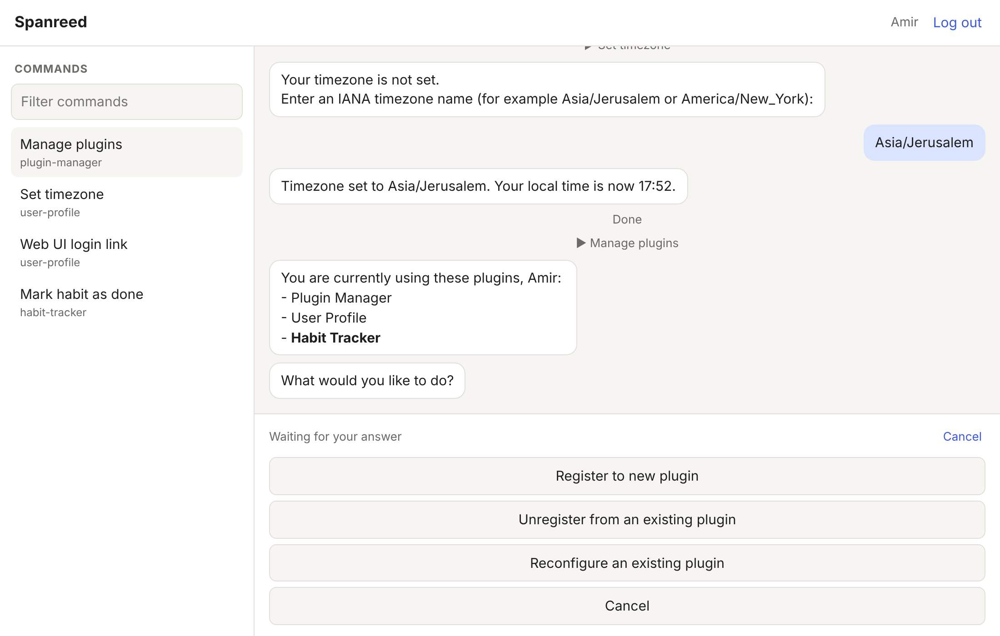

# Web UI for commands

`https://spanreed.ink/app/` runs the same commands as the Telegram `/do` menu
and the Obsidian palette, in a browser. It exists for when Telegram flood
control blocks the bot: a command started here never touches Telegram.



## How it fits

- **A third interaction surface.** `spanreed.interaction.web_surface.WebSurface`
  implements `UserInteractionSurface` next to Telegram and Obsidian. Plugins
  don't change: `send_message`, `request_user_choice`, `request_user_input`,
  `notify`, `send_document`, edits and deletes all render in the page.
- **Same registry, same flow semantics.** The command list is
  `commands.commands_for_user(user)`. Running one starts a HIGH-priority
  user-initiated flow through `engine.start_user_flow` (the slot shared with
  `/do` and the palette, newest wins), scoped with
  `SurfaceScope(origin_surface="web")` so all of the flow's traffic goes to
  the page only.
- **Proactive prompts too.** While a page is open (it polls at least every
  25s; presence lasts 60s), broadcast traffic from plugins also reaches the
  web UI, so it can answer a prompt that Telegram failed to deliver.
- **Transport.** Plain HTTP: JSON calls plus a long-poll on
  `/app/api/events`. No WebSocket, so nothing to change in nginx. The feed
  is in-process memory, like the engine's pending prompts, so it resets on
  restart; the page reloads its state when that happens. `notify()` is also
  kept in a small Redis inbox (`web-surface:{user_id}:inbox`).

The routes are a Quart blueprint (`spanreed.web.routes`) registered on the
existing Web UI plugin app on `127.0.0.1:5000`, which nginx already proxies
for the OAuth callbacks.

## Logging in

1. Run **Web UI login link** (User Profile plugin, so every user has it)
   from `/do` or the Obsidian palette. It sends a link that works once and
   expires in an hour. Opening the link shows a **Log in** button, and only
   pressing it (a POST) uses the link up. Chat apps fetch links to build
   previews, so a link that logged you in on GET would be used up by
   Telegram's preview before you tapped it.
2. Opening it starts a session: an `HttpOnly`, `Secure`, `SameSite=Lax`
   cookie on `/app`, valid for 90 days. Log in once while Telegram works and
   you keep access through a ban.
3. If no surface can deliver a link, on the server:

   ```bash
   runuser -l spanreed -c 'cd /opt/spanreed && /home/spanreed/.pyenv/bin/pyenv exec poetry run python -m spanreed.web.login_link <user_id>'
   ```

Tokens and session ids are stored only as SHA-256 digests in Redis
(`web-ui:login-token:*`, `web-ui:session:*`). Every write request needs the
`X-Spanreed-Request: 1` header, which a cross-site page can't send without a
CORS preflight, so the cookie can't be used for CSRF. An answer is accepted
only for a prompt that belongs to the logged-in user.

## nginx

Nothing to change if nginx proxies the whole site to `127.0.0.1:5000`
(which the OAuth callbacks and the `/` smoke check imply). If it proxies only
specific locations, add:

```nginx
location /app/ {
    proxy_pass http://127.0.0.1:5000;
    proxy_set_header Host $host;
    proxy_set_header X-Forwarded-Proto $scheme;
    proxy_read_timeout 60s;   # the long-poll holds for 25s
    proxy_buffering off;
}
```

## Sign in with Google

A permanent way in, so you don't need a new login link for each device.

1. Log in once with a login link, then choose **Link Google account** in
   the header. That links your Google account to your Spanreed user.
2. From then on, **Sign in with Google** on the login page logs you in.
   A Google account that isn't linked can't sign in. **Unlink Google**
   in the header removes the link.

How it works: OpenID Connect authorization-code flow
(`spanreed.web.google_auth`), scopes `openid email`. The `state` is
single-use, kept in Redis for 10 minutes, and bound to the browser by a
cookie, which blocks login CSRF. The ID token's signature, audience, expiry
and `nonce` are checked, and its email must be verified. Links live in Redis
as `web-ui:google-sub:{sub}` → user id and `web-ui:user:{id}:google`. A
Google account can be linked to only one Spanreed user.

**Server setup (one time):**

- OAuth client: the server uses the client JSON under the Redis key
  `web_ui_google_credentials`. If that key isn't set, it uses the client
  that Gmail or Google Fit already use (`gmail_credentials`, then
  `googlefit_credentials`).
- In Google Cloud Console → APIs & Services → Credentials → that OAuth
  client, add the authorized redirect URI
  `https://spanreed.ink/app/google/callback`. Until you do, Google rejects
  the sign-in with `redirect_uri_mismatch`.
- If the consent screen is in "Testing", the Google account must be one of
  its test users.

The Google button only appears when a client config is found.

## Server logs

`https://spanreed.ink/app/logs` shows the server's log lines live, as they
are logged. It needs a web UI session, and only admins can see it, because
the logs cover every user. The stream is Server-Sent Events from
`/app/api/logs/stream`, relaying the Redis `logs` channel that
`RedisPubSubHandler` publishes to. It is plain HTTP, so it needs no
WebSocket support in nginx; the response sets `X-Accel-Buffering: no` so
nginx doesn't buffer it.

Admins are the user ids in the Redis set `web-ui:admins`. While that set is
empty, user 1 (the first account) is the admin. To change the set:

```bash
poetry run python -m spanreed.web.admins list|add <id>|remove <id>
```

`/` redirects to `/app/`. `/healthz` is the unauthenticated check the
deploy workflow uses.
