# Workflows

A workflow is an automation that a user owns: one trigger and an ordered list
of steps. Plugins publish the blocks that triggers and steps are made of, and
one engine runs every workflow.

This replaces behavior that used to be written into a plugin. A plugin decided
when it ran, what it did and whether it told you. A workflow keeps those apart,
so that each can be changed without code.

A workflow comes from a recipe, or is built in the web UI from a trigger and
the blocks of the user's plugins. The web UI shows a workflow's steps and the
history of its runs, turns it on and off, runs it and edits it (see
[web-ui.md](web-ui.md#workflows)). The chat command **Manage workflows**
lists, switches and runs workflows, and also adds one from a recipe and
deletes one. Editing is in the web UI only.

## The parts

| Part | What it is | Where |
| --- | --- | --- |
| Block | A unit with typed inputs and outputs. An `Action` is a step. A `Trigger` starts runs. | `spanreed/workflows/blocks.py` |
| Workflow | A trigger, steps, a name, and whether it is on. Stored as JSON for each user. | `spanreed/workflows/model.py` |
| Run | One execution, for one event of the trigger. Its trace holds what each step received and returned. | `spanreed/workflows/engine.py` |
| Recipe | A workflow that ships with Spanreed. Installing one copies it to the user. | `spanreed/workflows/recipes/*.json` |

`WorkflowsPlugin` (`spanreed/plugins/workflows.py`) is a core plugin, like User
Profile: every user is registered to it. It builds the block registry from
`Plugin.blocks()` of every loaded plugin, starts the engine, and owns **Manage
workflows**.

## A workflow as JSON

This is the recipe that replaced the Todoist No Overdue plugin:

```json
{
  "id": "todoist-no-overdue",
  "name": "Daily chores never overdue",
  "requires": ["todoist"],
  "command_hidden": true,
  "trigger": {"block": "core.schedule", "params": {"every": 4, "unit": "hours"}},
  "steps": [
    {"id": "find", "block": "todoist.find-tasks",
     "inputs": {"label": "spanreed/no-overdue", "due": "overdue"}},
    {"id": "any", "block": "core.continue-if",
     "inputs": {"condition": "{{ find.count > 0 }}"}},
    {"id": "move", "block": "todoist.set-due-date",
     "inputs": {"tasks": "{{ find.tasks }}", "due": "today"}},
    {"id": "tell", "block": "core.send-message",
     "inputs": {"message": "Updated {{ find.count }} overdue tasks to today."}}
  ]
}
```

A step's inputs can refer to what came before it, in Jinja syntax:

- `trigger`: the outputs of the trigger's event.
- `run`: the run itself. `{{ run.manual }}` is true for a run started by hand.
- The `id` of an earlier step: its outputs.

A text with a template in it gives text. A text that is one expression and
nothing else gives the value itself, so `"{{ find.tasks }}"` is a list and
`"{{ find.count > 0 }}"` is yes or no. Templates run in Jinja's sandbox, and a
name that does not exist is an error.

A workflow is checked when it is installed and when the engine starts: every
block must exist, the inputs must fit the block, and a template can only refer
to the trigger, the run or an earlier step. A workflow with a problem is not
started, and **Manage workflows** says what the problem is.

A user's own workflow goes out in the same JSON (**Export** on its page),
and comes in again as a new workflow (**New workflow → From a file**):
`spanreed/workflows/sharing.py`. The file is a recipe, so a workflow that
someone built can be put in `recipes/` as it is, with a description. What
comes in is checked from the ground up, as above, and is refused with what
is wrong if this Spanreed cannot run it. It starts turned off, and it never
takes the `id`, the user or the state of the workflow it was made from:
the file holds none of them.

### Steps inside a step

A step whose block is a loop holds steps of its own. `core.for-each` runs
them once for each item of a list. This is from the recipe that writes a note
for each set of a Hevy workout:

```json
{"id": "each", "block": "core.for-each",
 "inputs": {"items": "{{ trigger.sets }}"},
 "steps": [
   {"id": "note", "block": "obsidian.write-note",
    "inputs": {
      "path": "Fitness/Sets/{{ trigger.folder }}/{{ each.item.note_name }}.md",
      "properties": {"exercise": "{{ each.item.exercise }}", "reps": "{{ each.item.reps }}"},
      "body": "{{ each.item.summary }}"}}
 ]}
```

- Inside the loop, the id of the loop's step gives the item the steps run
  for, and its place: `{{ each.item }}`, `{{ each.index }}` (from 1) and
  `{{ each.count }}`. After the loop it gives `{{ each.count }}`.
- The steps inside can also refer to the trigger, the run, the steps before
  the loop and each other. A step after the loop cannot refer to a step
  inside it.
- Ids are unique in the whole workflow. The engine and the page number the
  steps inside step 2 as 2.1, 2.2.
- "Only continue if" inside a loop ends the steps for that item, and the loop
  goes on with the next one.
- A step inside that fails makes the loop fail, and with it the run: `failed
  at step 1, For each: Item 3 of 5, Write note: …`. The run is tried again
  from its first step, so the items before are done again.
- The trace keeps the first 50 rounds of a loop, and the one that failed.

A step whose block is a branch holds two lists of steps and runs one of
them. `core.if` runs `steps` if its condition holds, and `otherwise` if not:

```json
{"id": "found", "block": "core.if",
 "inputs": {"condition": "{{ files.count > 0 }}"},
 "steps": [
   {"id": "tell", "block": "core.send-message",
    "inputs": {"message": "Saved {{ files.count }} files."}}
 ],
 "otherwise": [
   {"id": "nothing", "block": "core.send-message",
    "inputs": {"message": "There was nothing to save."}}
 ]}
```

- The steps on a side can refer to what is before the branch, to the branch
  (`{{ found.yes }}`) and to the steps before them on the same side. A step
  after the branch can refer to the branch, and not to a step inside it: only
  one side ran.
- The second side goes on counting where the first stopped: 2.1 and 2.2 on
  the first side, 2.3 on the second.
- "Only continue if" on a side ends the run, or the round of the loop that
  the branch is in.
- A step on a side that fails makes the branch fail: `failed at step 2, If:
  Write file: …`.
- The trace says which side ran, and holds its steps.
- A side can be empty.

A step cannot have an id that templates read as something else: `if`, `not`,
`in`, `and`, `or`, `is`, `else`, `true`, `false`, `none`.

## Blocks

| Block | Kind | Published by |
| --- | --- | --- |
| `core.schedule` On a schedule | trigger | Workflows |
| `core.at-time` At a time of day | trigger | Workflows |
| `core.random-schedule` At random times | trigger | Workflows |
| `core.called` When another workflow runs it | trigger | Workflows |
| `core.command` When I run its command | trigger | Workflows |
| `core.started` Spanreed started | trigger | Workflows |
| `core.error` Spanreed had an error | trigger | Workflows |
| `core.continue-if` Only continue if | logic | Workflows |
| `core.if` If | logic | Workflows |
| `core.for-each` For each | logic | Workflows |
| `core.stop` End the run | logic | Workflows |
| `core.call-workflow` Run a workflow | logic | Workflows |
| `core.run-one` Run one workflow | logic | Workflows |
| `core.remember` Remember | logic | Workflows |
| `core.recall` Recall | logic | Workflows |
| `core.forget` Forget | logic | Workflows |
| `core.ask-choice` Ask me to choose | ask | Workflows |
| `core.ask-each` Ask me to pick, one at a time | ask | Workflows |
| `core.ask-text` Ask me for text | ask | Workflows |
| `core.ask-list` Ask me for a list | ask | Workflows |
| `core.send-message` Send message | ask | Workflows |
| `core.notify` Notify me | ask | Workflows |
| `core.send-file` Send file | ask | Workflows |
| `core.download-file` Download a file | action | Workflows |
| `todoist.find-tasks` Find tasks | action | Todoist |
| `todoist.set-due-date` Set due date | action | Todoist |
| `todoist.read-tally` Get the dates on a task | action | Todoist |
| `todoist.write-tally` Write the dates to a task | action | Todoist |
| `obsidian.create-daily-note` Create today's daily note | action | Obsidian |
| `obsidian.query-dataview` Query Dataview | action | Obsidian |
| `obsidian.get-note-property` Get note property | action | Obsidian |
| `obsidian.set-note-properties` Set note properties | action | Obsidian |
| `obsidian.add-to-list-property` Add to list property | action | Obsidian |
| `obsidian.write-file` Write file | action | Obsidian |
| `obsidian.write-note` Write note | action | Obsidian |
| `obsidian.append-to-note` Append to note | action | Obsidian |
| `obsidian.stopped-answering` Vault stopped answering | trigger | Obsidian |
| `health-connect.day-changed` A day's data changed | trigger | Health Connect |
| `health-connect.raw-records-changed` Raw records changed | trigger | Health Connect |
| `withings.new-measurements` New measurements for a day | trigger | Withings |
| `hevy.new-workout` New workout | trigger | Hevy |
| `gmail.new-email` New email | trigger | Gmail Monitor |
| `gmail.get-attachments` Get attachments | action | Gmail Monitor |
| `gmail.find-links` Find links | action | Gmail Monitor |
| `lit-notes.search-books` Search books | action | Lit Notes |
| `audible.get-library` Get library | action | Audible |
| `audible.link-note` Link a note to a book | action | Audible |
| `timekiller.journal` Journaling prompt | ask | Timekiller |
| `timekiller.reading-check-in` Reading check-in | ask | Timekiller |
| `timekiller.process-scan` Process a scan | ask | Timekiller |

More arrive with each plugin whose behavior becomes a recipe.

"Send message" goes to where the user is now. "Notify me" leaves a
notification on every surface the user has: one that cannot show it now
keeps it until it can. It is for what must not be missed and need not be
seen at once. With **Markdown** its text is read as Markdown, so that what
is between two lines of ``` is shown as code.

### Asking

Four blocks ask the user something. Each has the same two inputs at its end,
**Priority** and **Give up after** (see [The turn to talk](#the-turn-to-talk)).

| Block | Asks | Gives |
| --- | --- | --- |
| Ask me to choose | A question with one button for each option | `chosen`, `answer` (the text), `item` (the option as it was given), `index` (from 1) |
| Ask me to pick, one at a time | The same question again and again, without the options picked so far, until **Done** | For each pick: `answer`, `value`, `picked`, `count`, `left`. After: all of `picked` |
| Ask me for text | A question that is answered in writing | `answer`, `answered` |
| Ask me for a list | "Add one?" and then the question, until the answer is No | `answers`, `count` |

- **The options of "Ask me to choose"** are texts, or things that have a text
  to show, such as the books of a search. For those the text is their
  `label`, `title` or `name`, or what **Show** names, and `item` is the whole
  thing that was chosen: `{{ book.item.title }}`.
- **A long list** is shown some **at a time**, with "Show more" while there is
  more.
- **One option** can be asked about with a question of its own (**If one**),
  with Yes and No.
- **Choosing nothing** does not end the run. `chosen` is false for Cancel, for
  No, and when there was nothing to choose from. An "If" after the step
  decides what happens then.
- **"Ask me for text" can ask first** whether there is anything to write
  (**Ask first**). On No, the answer is empty.

"Ask me to pick, one at a time" holds steps, as a loop does, under **After
each pick**. They run for a pick before the next question is asked, so a
pick is acted on even if the user never answers again:

```json
{
  "id": "pick",
  "block": "core.ask-each",
  "inputs": {
    "question": "Did you do any of these habits today?",
    "options": {"Meditate": "meditate", "Read": "read"},
    "leave_out": "{{ done.items }}"
  },
  "steps": [
    {
      "id": "mark",
      "block": "obsidian.add-to-list-property",
      "inputs": {
        "note": "Daily/{{ trigger.date }}.md",
        "property": "habits",
        "value": "{{ pick.value }}"
      }
    }
  ]
}
```

- **Options** are rows: what a button says, and the value that picking it
  gives. The page edits them as rows, so adding an option is adding a row.
- **Leave out** holds values that are not offered. Nothing is asked, and the
  run does not take the turn to talk, when no option is on offer.
- **A step inside that fails** fails the run: `failed at step 3, Ask me to
  pick, one at a time: Pick 2, Add to list property: …`. The picks before it
  were acted on.

"End the run" ends the run where it is, without failing it. Inside a loop it
ends the loop too, where "Only continue if" ends only the round it is in.

"When I run its command" is the trigger of a workflow that is only a command:
it starts no run by itself.

### The turn to talk

Spanreed talks to a user about one thing at a time: a plugin takes the
user's turn to talk around a conversation, and others wait for it
(`UserInteractionApi.user_interaction`). A run does the same.

- **A run takes the turn at its first question**, and keeps it until the run
  ends. Its questions are one conversation, and nothing else asks in
  between. The steps before the first question run without the turn, and a
  run that asks nothing never takes it: a step that may ask and this time
  does not, such as a search with no results, costs nothing.
- **A run started by hand has the turn already.** The flow of its command
  took it, so the questions come up where the command was started.
- **Priority** says how a run in the background waits for the turn. `normal`
  waits behind a conversation that is open, and gives way to a command that
  the user starts. `low` also gives way to any other conversation that
  starts. `high` takes the turn from a conversation of normal or low
  priority, and gives way to nothing. Only the first question's priority
  counts: the run has the turn after it.
- **A run that gives way ends there**, without failing: `stopped at step 3,
  Ask me to choose. Another conversation took over.` It is not tried again.
  Its trigger goes on with the next event.
- **Give up after** is how many minutes a question waits for the user. After
  that the run ends, without failing. The wait for the turn is not part of
  it. 0 waits for as long as it takes, and the workflow runs for nothing
  else in that time.
- **A run that waits for the turn lets a run by hand of the same workflow go
  first.** The run by hand has the turn, and would wait for the workflow in
  return.
- **A run by hand that spoke is not summed up.** If the one run of a command
  asked or told the user something and did not fail, nothing is added to
  that. See [Commands](#commands).
- **A workflow that asks is not tested** by the editor: a test is not a
  conversation. Use **Run now**.

The history keeps, with each step that asked, what was asked and what the
answer was.

A block that asks sets `converses` and talks through `ctx.interaction`. That
has the methods of `UserInteractionApi` that a conversation is made of
(`request_user_choice`, `request_user_input`, `send_message`,
`send_document`), so the body of a plugin's conversation moves into a block
as it is. A question takes the turn by itself. The block does not take it:

```python
class ProcessScan(Action[ProcessScanInput, ProcessScanOutput]):
    id = "timekiller.process-scan"
    title = "Process a scan"
    converses = True

    async def run(self, ctx: StepContext, inputs: ProcessScanInput) -> ProcessScanOutput:
        bot = ctx.interaction
        choice = await bot.request_user_choice("Keep this scan?", ["Yes", "No"])
        ...
```

Give the inputs a `priority` and a `give_up_after` with `priority_field()`
and `give_up_field()` of `spanreed.workflows.asking`, and the card has the
two inputs that the built-in blocks have.

An `AskLoop` is a loop whose rounds are answers. The engine calls `ask`
before each round with the rounds so far, and runs the steps inside for what
it returns, until it returns `None`. `after` gives what the steps after the
loop see.

"Link a note to a book" of Audible is such a block: the conversation of a
plugin, moved into one card (`spanreed/apis/audible_blocks.py`).

### Memory

A workflow has a memory of its own: JSON values under names, kept from one
run to the next. It survives a restart and is deleted with the workflow.

| Block | Does | Gives |
| --- | --- | --- |
| Remember | Keeps a value under a name. Without a value: only that it is remembered | |
| Recall | Reads what is kept under a name | `found`, `value`, `at` (when it was kept, in UTC), `age_hours` (how long ago that was) |
| Forget | Drops what is kept under a name | `found` |

The usual use is to do something once for each thing, however often it comes
up:

```json
[
  {"id": "asked", "block": "core.recall", "inputs": {"name": "finish-prompted:{{ book.asin }}"}},
  {"id": "once", "block": "core.continue-if", "inputs": {"condition": "{{ not asked.found }}"}},
  {"id": "mark", "block": "core.ask-choice", "inputs": {"question": "Mark it as read?", "options": ["Yes", "No"]}},
  {"id": "keep", "block": "core.remember", "inputs": {"name": "finish-prompted:{{ book.asin }}"}}
]
```

"Remember" comes after the question, so a question that got no answer is
asked again at the next run.

For something to do at most every so often, the condition is `{{ not
last.found or last.age_hours > 72 }}`.

The page of a workflow says how many things it remembers, lists the names,
and can make it forget one or all of them (`POST
/app/api/workflows/<id>/forget`, with `name` for one). A workflow that
forgets that it asked asks again. What the trigger remembers, such as a
cursor, is not part of this.

A block reaches the same memory as `ctx.memory`, with `get`, `set` and
`forget`. It is what a plugin used `get_user_data` and `set_user_data` for.
In a test of a block, `StepContext` has a memory that lasts as long as the
context does.

### One workflow runs another

A workflow can be a part of others. Its trigger is "When another workflow
runs it": it starts no run by itself. It has a command too, which a recipe
usually hides.

| Block | Does | Gives |
| --- | --- | --- |
| Run a workflow | Runs the workflow of that name, and goes on when it is over | `status`, `finished`, `outcome` |
| Run one workflow | Runs one of several: one picked at random, or the user's pick | `ran`, `status`, `on_offer` |

```json
{
  "id": "one",
  "block": "core.run-one",
  "inputs": {
    "workflows": {
      "Journaling Prompt": true,
      "Mood": "{{ not mood.found }}",
      "Books": "{{ run.manual or not last.found or last.age_hours > 72 }}"
    },
    "how": "{{ 'ask me' if run.manual else 'at random' }}",
    "question": "What's your poison?"
  }
}
```

- **The other workflow runs inside the run of the step**: in the same
  conversation, and the step is over when it is. Its trace is in its own
  history, marked with the name of the workflow that ran it.
- **A workflow is named, not linked.** A step finds it by its name among the
  user's workflows. Renaming it breaks the step, which then fails and says
  that there is no workflow of that name.
- **What can be run** is a workflow that is on, has nothing wrong with it,
  and whose trigger starts a run by hand without a question: a part, a
  command, a schedule. "Run a workflow" fails for any other. "Run one
  workflow" leaves it out, and does nothing if none is left.
- **A row of "Run one workflow"** is the name of a workflow and whether it is
  on offer: yes, no, or a condition.
- **A workflow cannot run itself**, directly or through another.
- **A part that fails fails the step**, and with it the run. The part is not
  tried again by itself: the run that needed it is.
- **A part whose conversation ends ends the run that ran it**: another
  conversation took the turn, or the user did not answer in time. The steps
  after the part would act on a conversation that never was. A part that
  ends its own run with "End the run" ends only itself.
- **A part that is in a run of its own** is waited for, for a minute. Then
  the step fails.
- **Test** does not run a workflow with one of these steps: the part may ask.

A block runs a workflow through `ctx.workflows`, with `run(name)` and
`on_offer(names)`.

### Files

A file is a value like any other: a step that gets files gives them as a
list, and a step that takes a file reads its `data`. A file has a `name`
that is safe to write it under, its `stem` and `extension`, its `type` and
its `size`. A trace shows the size of the data, not the data.

- `gmail.get-attachments` gives the attachments of an email as `files`.
- `core.download-file` gives the file that a link leads to. It follows HTTP
  redirects and pages that only send the browser on, and it fetches from
  public addresses only: each address on the way is checked. A link that
  does not lead to a file does not fail the step: `ok` is no and `problem`
  says why (a web page, a picture, too large, HTTP 404). The step fails, and
  the run is tried again, if the server does not answer or has an error.
- `obsidian.write-file` takes a text or the data of a file as its content.
  **If exists**: `skip` leaves a file that is there and sets `skipped`.
- `core.send-file` sends a file to the user.

This saves the PDF attachments of an email into the vault, and says for each
whether it was saved or was there already:


```json
{"id": "files", "block": "gmail.get-attachments", "inputs": {"email": "{{ trigger.id }}"}},
{"id": "each", "block": "core.for-each", "inputs": {"items": "{{ files.files }}"},
 "steps": [
   {"id": "save", "block": "obsidian.write-file",
    "inputs": {"path": "Receipts/{{ trigger.date }} {{ each.item.name }}",
               "content": "{{ each.item.data }}", "if_exists": "skip"}},
   {"id": "told", "block": "core.send-message",
    "inputs": {"message": "💾 Saved {{ save.path }}⚠️ {{ save.path }} already exists; skipped."}}
 ]}
```

The same workflow on a phone, and the blocks for files in the editor's list:

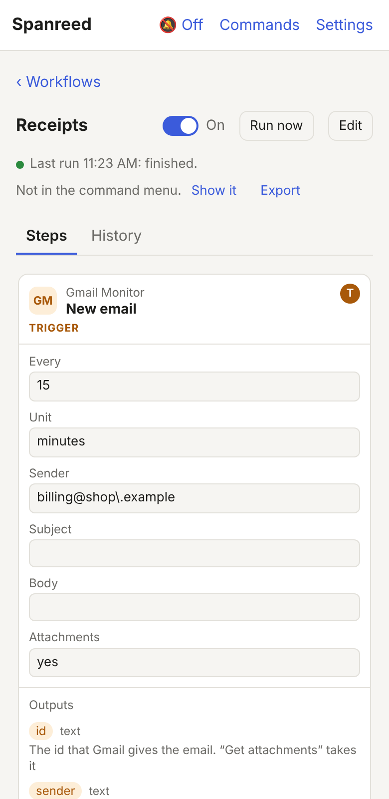


A message that comes out empty is not sent. So a message that is all inside
`` is sent only when the condition holds. The workflows that
Gmail Monitor's rules became say things this way. A workflow that is made
now can use "If" in its place.

### Gmail

`gmail.new-email` asks Gmail at its interval (15 minutes unless changed) for
the emails that came since its last poll, and fires for each one that matches
its filter: patterns for the sender, the subject and the body, and whether
the email has attachments. A pattern is a regular expression, searched
without regard to case.

- An email fires once for a workflow.
- The first poll of a workflow looks back an hour.
- A poll asks Gmail by the second (`after:1778320800`). Gmail takes a date
  (`after:2026/05/09`) as midnight in Pacific time, whatever the timezone of
  the user.
- If the Gmail login is no longer accepted, the poll sends the user a link to
  log in again, once, and keeps its place.
- By hand, the workflow runs for the new emails, or for every email in the
  inbox (or the starred ones) that matches, up to 200, after asking.

### Writing a block

An action names its input and output dataclasses as type arguments:

```python
@dataclass
class FindTasksInput:
    label: str
    due: Literal["any", "overdue"] = "any"

@dataclass
class FindTasksOutput:
    tasks: list[Any]
    count: int

class FindTasks(Action[FindTasksInput, FindTasksOutput]):
    id = "todoist.find-tasks"      # stable: stored workflows refer to it
    title = "Find tasks"

    async def run(self, ctx: StepContext, inputs: FindTasksInput) -> FindTasksOutput:
        todoist = await Todoist.for_user(ctx.user)
        ...
```

The plugin returns it from `blocks()`:

```python
class TodoistPlugin(Plugin[UserConfig]):
    def blocks(self) -> list[Block]:
        return todoist_blocks()
```

- The input values are checked against the dataclass with
  `spanreed.config_form`, the check that the settings form uses.
- A user's workflow can use a plugin's blocks while the user is registered to
  that plugin. Otherwise the step fails and says which plugin to set up.
- Raise `StopRun` to end the run at this step without failing it. Any other
  exception fails the run.
- A failed run is tried again from its first step, so a block must be safe to
  repeat.

A block that holds steps is a `Loop`: an action with a `rounds` method, which
returns what the steps inside see as the loop's outputs, once for each time
they run. `run` returns the outputs for the steps after the loop.

A block that chooses between two lists of steps is a `Branch`: an action with
a `takes_first` method, which says from the inputs whether the first list
runs or the second.

### Triggers

A trigger names its parameters and its event, and yields an event each time
the workflow should run. The fields of the event are its outputs.

```python
class Schedule(Trigger[Repeat, Tick]):
    id = "core.schedule"
    title = "On a schedule"
    Manual = NoQuestion

    async def events(self, ctx, params) -> AsyncIterator[Tick]:
        while True:
            ...
            yield tick
            await ctx.state.set("last_fired", ...)   # after the run is over
```

The engine runs the workflow for an event before it asks for the next one, so
the code after a `yield` runs when that run is over. The `yield` gives back
whether the run worked. `ctx.state` keeps small values, such as a cursor, for
each workflow across restarts.

#### Triggers that a plugin feeds

A `PushTrigger` is for a plugin that learns of changes itself, as Health
Connect does when the phone posts a payload. The plugin says what changed,
with one key for each thing:

```python
await DayChanged.emit(user, ["2026-05-09"])
```

The key waits in a queue, in Redis, for every workflow of the user that is on
and uses the trigger. The trigger turns a key into an event when the workflow
is ready to run for it:

```python
class DayChanged(PushTrigger[NoParams, DayMetrics]):
    id = "health-connect.day-changed"

    async def event_for(self, ctx, params, key) -> DayMetrics | None:
        return await day_metrics(ctx.user, datetime.date.fromisoformat(key))
```

- The event is built when the run starts, so it holds what is stored at that
  moment, and a key that is put twice before its run gives one run.
- A key leaves the queue when its run worked. A restart in the middle of a
  run finds the key again.
- If the run failed every time it was tried, the key goes behind the others
  and is tried again after them. Nothing is dropped while Obsidian is closed.
- A key that is put again during its own run stays, and gives another run.
- A workflow that is off gets no keys. It does not collect what it missed;
  a run by hand over a range fills that in.

#### Triggers that poll a service

A `PollTrigger` is for a service that has to be asked, such as Withings. Its
parameters are `Repeat` (every 1 hour, for example), and `poll` returns an
event for each thing the service has now:

```python
class NewMeasurements(PollTrigger[Repeat, DayMeasurements]):
    id = "withings.new-measurements"

    async def poll(self, ctx, params, cursor) -> Poll[DayMeasurements]:
        today = datetime.date.today()
        yesterday = today - datetime.timedelta(days=1)
        return Poll(events=await measurements_of(ctx.user, yesterday, today))

    def key(self, event) -> str:        # what the event is about
        return event.date

    def version(self, event) -> str:    # what state that is in
        return digest(event)
```

A poll usually finds what earlier polls found too. The trigger remembers
what the workflow ran for, and leaves those events out:

- `key` names the thing an event is about. By default the workflow runs once
  for a key.
- `version` makes it run again when the thing changed. `digest(event)`
  changes when any field of the event does.
- An event is remembered when its run worked. If the run failed every time
  it was tried, the next poll gives the event again. So a poll has to keep
  returning a thing until then: Withings is asked for yesterday too.
- A poll can return a `cursor` for a service that can be asked for what is
  new since a point. It is kept, and handed to the next poll, once every run
  of the poll worked.
- The first poll of a new workflow is at once. After a restart the next poll
  waits for the rest of the interval, as a schedule does.
- The trigger remembers its last 1000 keys (`remembers`).
- `new_events` polls now and returns what the workflow has not run for, for a
  trigger whose manual run checks at once. A run by hand that worked is
  remembered, so the next poll does not run for the same thing.
- `PollTrigger.start_from` hands a trigger that never polled a cursor and the
  keys that were handled before it existed. The Hevy conversion uses it.

`Manual` says whether the user can start a run by hand:

- `None`: no.
- `NoQuestion`: yes, and nothing is asked.
- A dataclass: yes, after the user answers a question for each field. A field
  that is a `Literal` is a choice, and a field that is a `str` is a text.
  `manual_events` gets the answers and returns the events to run.

A question can depend on an earlier answer, and a trigger can refuse an
answer:

```python
@dataclass
class WorkoutChoice:
    which: Literal["New workouts", "A specific date", "A workout ID", "All workouts"] = field(
        metadata={"prompt": "Write Hevy workouts for…"}
    )
    date: str = field(default="", metadata={
        "prompt": "Enter the date (YYYY-MM-DD):",
        "ask_if": {"which": "A specific date"},
    })
```

- `ask_if` names the answers that a question waits for. A question that is not
  asked leaves its field at its default.
- `manual_events` raises `ManualError` to tell the user why there is nothing
  to run: `No workout found on 2026-05-09.`
- `manual_run_done` tells the trigger how each run by hand went.

`core.schedule` keeps the time of its last event. After a restart it fires at
once if it is due and waits for the rest of its interval if it is not. A new
workflow fires at once.

`core.at-time` fires at a **Time** of day, on every day or on one day of the
week (**On**), in the timezone of the user's profile or in one of its own
(**Timezone**). It keeps when the next event is due: an event that came up
while Spanreed was not running fires when it is back, if that is within 12
hours, and is passed over after that. A new workflow waits for its first
time. The `date` and `time` of an event are those it was due at.

`core.random-schedule` waits a different time before each event, picked at
random between **At least** and **At most**. With **Only from** and **Only
until**, two times of day in the user's timezone, a wait that ends outside
those hours fires nothing, and the next wait starts. It keeps when the next
event is due, so a restart does not fire early. By hand it fires whatever
the hour.

`core.started` fires when Spanreed has started: once the engine runs and
the plugins were moved. A workflow that was on at that moment gets the
event, also if it cannot run until later. One that is turned on afterwards
waits for the next start. `core.error` fires for an error that Spanreed
kept (see [Spanreed Monitor](#spanreed-monitor)), with its `text`. The
plugin that runs the engine feeds both, and neither can be started by hand.

`obsidian.stopped-answering` fires when Obsidian's plugin for Spanreed gave
no sign of life for **After** minutes, and again every **At most every**
minutes for as long as it stays quiet. It does not fire more often than
that when Obsidian comes and goes either, or after a restart of Spanreed.
The plugin says that it runs for as long as Obsidian is open, so the
trigger fires whenever Obsidian is closed: it is for a vault that is meant
to be open all the time. The Obsidian connector reads what the plugin says
(`spanreed/apis/obsidian_watch.py`), for each of its users.

## Commands

A workflow whose trigger can be started by hand is a command, on every
surface, for the user who owns it. The command:

- has the id `workflow.<workflow id>`, so that renaming the workflow does not
  change it for surfaces that remember commands;
- is named after the workflow, unless the workflow has a `command_name`;
- is on by default, and `command_hidden` takes it out of the menu. A recipe
  that replaces a plugin ships with the commands that the plugin had, so
  "Daily chores never overdue" ships hidden;
- goes away while the workflow is off.

A run started by hand happens inside the command's flow, so its messages and
its questions stay on the surface it was started from. It is not tried again
if it fails, and it ends with one line that says how it went: `Daily chores
never overdue: done. The run ended at step 2, Only continue if.` Several runs
are counted: `3 runs. 1 finished, 2 ended early, 0 failed.` A run that a block
ended on purpose did what it was asked to, so the line does not call it
stopped. There is no such line after one run that asked or told the user
something and did not fail: "Updated 2 overdue tasks to today." needs no
"finished." after it.

A command that opens a conversation of its own, as plugins do with `async with
bot.user_interaction()`, used to wait for the turn that its own flow held. A
task that has the turn now enters again without waiting.

`spanreed.interaction.commands` can now register a command for one user, and
surfaces check a command with `get_command_for_user` before they run it.

## What the engine does

- **One event, one run. One run at a time for each workflow.**
- **A failed run is tried again** for the same event: five times in all, with
  a pause of 60 seconds that doubles. After the last try the user is told
  once, and not again until a run works. The workflow stays on.
- **A workflow that keeps failing is tried twice an hour.** After those five
  tries, each event gets one try, no sooner than 30 minutes after the last
  failure, until a run works. A service that is down for a night is not asked
  hundreds of times.
- **A trigger that fails is started again** after a pause that doubles from 60
  seconds to 30 minutes, like a plugin that crashed.
- **Telegram flood control pauses the step**, not the run: the step waits for
  the ban plus a random extra and is tried again, up to three times. A run
  started by hand does not wait.
- **Values stay out of the log.** The engine logs which step ran and how it
  ended. A step's inputs and outputs are kept only in the run's trace.
- **Turning a workflow on or off takes effect at once.**

- **A run that asks holds the user's turn to talk** from its first question
  to its end. See [The turn to talk](#the-turn-to-talk).

### A run goes on after a restart

A run keeps its place when it starts and after each of its steps: the event
it runs for, the steps that are done as the history shows them, and what
each of them gave. The place is dropped when the run is over. If Spanreed is
restarted in between, the run goes on from its first step that is not done.
A question that waited for its answer is asked again.

- **A restart in the middle of a step starts the step over.** A step that
  holds steps, a loop for example, is one step: it starts with its first
  round again. So a block must be safe to repeat, as it must be for a run
  that is tried again.
- **A run that a trigger started goes on when the trigger gives its event
  again.** A trigger marks an event as done only once its run is over, so
  after a restart it gives the event that was cut short first. The engine
  asks the trigger whether it is the same one (`Trigger.same_event`): by
  default, if it is equal in every field. What a poll finds is the same if
  the thing is as it was, by its key and its version. The first event of
  "On a schedule" and of "At random times" stands for the one that was cut
  short, at whatever time it comes. If the event is another one, the place
  is dropped and a new run starts.
- **A run that the user started by hand goes on when Spanreed starts.**
  Only the run that was in progress: if the command was to run for several
  things, a week of days for example, the ones after it are not run.
- **What a step gave is kept only if it can be made again as it was**: no
  values, numbers, texts, and lists and mappings of those. From a step that
  gave more than that, bytes or an object of a class, the place is the
  start of the run, and the run starts over after a restart. The steps that
  go on must not work with something else than they would have. The event
  of a run by hand has to be plain in the same way, or the run is not gone
  on with. The event of another run comes from its trigger.
- **A place is for the workflow as it was.** If the trigger or the steps
  changed in the meantime, the run is not gone on with.
- **A run that ends for any other reason keeps no place**: one that failed,
  one that a step ended, one that lost the turn to talk, one whose workflow
  was turned off, and a run by hand that the user stopped by starting
  another command.
- **A place larger than 200,000 characters is not kept.** Such a run starts
  over, as every run did before.
- A test keeps no place, and neither does a run inside the step "Run a
  workflow": it starts over with that step.

The history shows such a run once, with "went on after a restart" next to
how it was started.

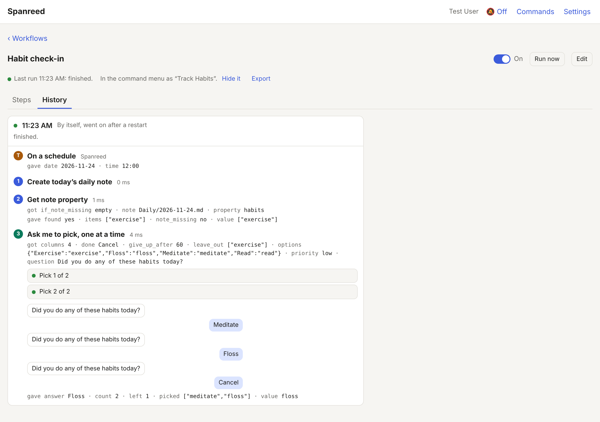

## Editing

The page edits a workflow's name, the text of its command, the inputs of its
trigger and steps, and which steps there are and in what order.
`spanreed/workflows/editing.py` moves a workflow between what is stored and
what the forms hold.

Every input is edited as text, because any input can hold a template where
its type asks for a number or a list. There are three controls:

| Control | For | What is stored |
| --- | --- | --- |
| Text | Texts, numbers, yes/no, lists, anything else | A text with a template is stored as it is. Without one, it becomes what the input asks for: `4`, `yes`, `["a", "b"]`. |
| Choice | A `Literal` | The choice |
| Rows | A mapping, such as the properties to set | A name and a value for each row, in the order of the rows |

The value of a row, and an input of any type, keeps a text that reads as a
number, `true`, `false`, `null` or a list as that value, so `5` is the number
five. A text in quotes, `"5"`, is the text. Anything else is a text.

Saving sends the whole workflow to `PUT /app/api/workflows/<id>`. Nothing is
stored unless every value fits its input and the engine can run the result
(see `model.problems`): the answer lists what has to change, as the page
shows it. A saved edit takes effect at once: the trigger starts again with
the new values and keeps what it remembers.

A card gets the list of values it can use from the cards before it. A step
inside a loop is also offered the fields of the loop's items, when the loop
goes over an output whose items are known, such as the sets of a workout.

What a workflow can be made of comes from `GET /app/api/workflows/catalog`:
every block with the card of a new step of it, and every recipe. A block of a
plugin that the user is not registered to is listed and cannot be picked, and
so is a recipe that needs such a plugin.

- **A new step** gets an id after its block: `write_note`, then
  `write_note_2`. Ids are not shown and cannot be changed. A step that is
  removed or moved while a later step still refers to it is a problem that
  Save reports.
- **A new workflow** is made with `POST /app/api/workflows`, from a recipe or
  with only a trigger. One that starts with only a trigger is off, so that
  its trigger does not start to count things as done before there are steps.
- **The trigger of a workflow cannot be changed.** What a trigger remembers
  (a cursor, the things it ran for) belongs to that trigger.
- **Deleting** a workflow (`DELETE /app/api/workflows/<id>`) deletes its
  history and what its trigger remembers.

### Testing

`POST /app/api/workflows/<id>/test` runs a workflow once as the editor holds
it, without storing it, and returns the trace.

- **The run is real.** The steps do what they do. It is not tried again if it
  fails, `{{ run.manual }}` is true in it, and its trace is kept in the
  history with `test` set.
- **It runs for the last event**, the one the stored workflow last ran for.
  The engine keeps that event whole for each workflow: a trace keeps only the
  start of a long text or list, and a test that ran for a trace would write
  the shortened value. For a trigger whose `Manual` is `NoQuestion` it can
  also run for an event that the trigger makes at that moment.
- **The kept event reads like the original** in templates: `{{ trigger.date
  }}`, `{{ each.item.reps }}`. A block gets plain values from it, not the
  objects the trigger made.
- **A workflow that asks the user something is not tested.** The route
  answers 400 and the page says so. Run it by hand.

### What a step writes

A block can name what a step of it writes that another step could write too:

```python
class SetNoteProperties(Action[...]):
    def writes(self, inputs: dict[str, Any]) -> list[str]:
        return [f"the property “{name}” of {inputs['note']}" for name in inputs["properties"]]
```

`inputs` are the stored inputs, templates and all. Two steps that give the
same name write the same thing. The page says so on a workflow when another
workflow of the user that is on gives a name that it gives too. It is not a
problem: both run.

## Redis

| Key | Holds |
| --- | --- |
| `workflows:user_id={id}` | Set of the user's workflow ids |
| `workflows:workflow:{id}` | The workflow, as JSON |
| `workflows:workflow:{id}:state` | Hash of what its trigger remembers: when it last fired or polled, a cursor, the keys it ran for |
| `workflows:workflow:{id}:memory` | Hash of what its steps remember, each value as JSON with the time it was kept |
| `workflows:workflow:{id}:runs` | The traces of its last 100 runs, newest first. Dropped 30 days after the last run. |
| `workflows:workflow:{id}:last_event` | The event it last ran for, whole, with the time of the run. Dropped 30 days after the last run. |
| `workflows:workflow:{id}:queue` | List of the keys it still has to run for, oldest first |
| `workflows:workflow:{id}:queued` | Hash of those keys, each with a token that changes when the key is put again |
| `workflows:workflow:{id}:places` | Hash of how far each run that is not over got, by the id of the run: see [A run goes on after a restart](#a-run-goes-on-after-a-restart). Dropped 30 days after the last run. |
| `workflows:converted:{plugin}` | Set of the users whose use of a plugin was converted to recipes |
| `workflows:to-convert:{plugin}` | JSON list of the users the plugin had when it became recipes, and who are not converted yet |

## Plugins that became recipes

`spanreed/workflows/migrations.py` moves the users, once each, at startup. A
user never has the old behavior and the new one, and doing it again changes
nothing.

### Retired: the whole plugin is a recipe

The plugin is deleted from the code. Each user who is still registered to it
gets the recipe and is told so, and the registration is dropped.

| Plugin | Recipe |
| --- | --- |
| Todoist No Overdue | Daily chores never overdue |
| Habit Tracker | Habit check-in |
| Audible Book Progress | Audible progress → book notes |
| Recurring Payments | A workflow for each payment the user had. For a new one: Recurring payment |
| Spanreed Monitor | Spanreed started, Spanreed had an error and, turned off, Obsidian stopped answering |

A retired plugin can carry over the config it had saved for a user
(`RetiredPlugin.keep_settings`), and what it remembered for the user
(`RetiredPlugin.carry_over`). Both stay in Redis after the plugin is gone.
A plugin that held several things, each of which is a workflow now, makes
them itself (`RetiredPlugin.move`).
A workflow that waits for what a plugin remembered is off until it has it,
and a move that stopped halfway is finished at the next start.

The schedule of "Daily chores never overdue" differs from the plugin in one
way: the plugin ran at every start of Spanreed and then every 4 hours, and
the recipe runs every 4 hours whether or not Spanreed was restarted in
between.

#### Habit Tracker

The plugin asked, every hour, which of the user's habits were done today, and
marked each one in a property of the daily note.


Where the parts of the plugin went:

| Was | Is now |
| --- | --- |
| The habits | The rows of **Options** on "Ask me to pick, one at a time": what the button says, and the name that is written |
| Add Habit, Remove Habit | Gone. Add or remove a row in the editor |
| Track Habits | The command of the workflow, with the same name |
| The folder of the daily notes | The start of **Note** on "Get note property" and "Add to list property" |
| The name of the property | **Property** on the same two steps |
| Asking with low priority | **Priority** `low` on the question |
| A new question every hour | The schedule, every hour, and **Give up after** 60 minutes |

`spanreed/plugins/habit_check_in.py` is what is left of the plugin: it turns
the saved config into those inputs. A user who had no config gets the
workflow turned off, with the recipe's example habits.

- **A habit is shown as the plugin showed it**, with a capital first letter
  and the rest in small letters, and written as the user named it: the row
  `Take vitamin d` gives `take vitamin D`.
- **The note is the one of the day the question is about**:
  `{{ trigger.date }}`, the date of the schedule's event in the user's
  timezone. A question asked at 23:30 and answered at 00:10 marks
  yesterday's note. The plugin used the server's date, and dropped the
  question at midnight.
- **A question that gives way is asked again at the next hour**, not at once.
  The plugin asked again as soon as the other conversation was over.
- **The plugin's two messages are not sent.** A property that holds something
  that is not a list counts as no habits done; the plugin said "Invalid
  value" each time. A daily note that is not there after it was asked for
  counts as one without the property; the plugin said "Generating today's
  daily note..." and tried once more.
- **Run by hand with nothing left to ask**, the workflow says "Habit
  check-in: finished." The plugin's command said nothing.

`spanreed/plugins/habit_check_in_test_data.py` holds five days and what the
plugin did on each, taken by running it before it was removed. The tests run
the workflow on the same days and compare.

#### Audible Book Progress

The plugin wrote how far each book the user is reading was listened to on
Audible to the book's note, and offered once to mark a finished book as read.
It is the recipe "Audible progress → book notes" now, and the plugin is gone.
Audible, which holds the login, publishes the two blocks.

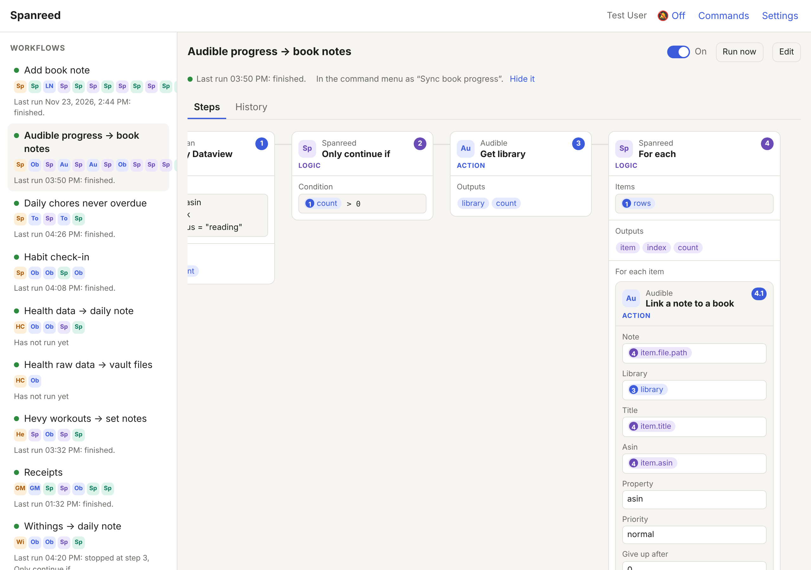


Where the parts of the plugin went:

| Was | Is now |
| --- | --- |
| The query for the notes of the books being read | **Query** on "Query Dataview" |
| Matching a note to a book, and asking which one it is | "Link a note to a book", one block with the conversation inside |
| Writing the progress if it changed | "Set note properties", **Write when** `changed` |
| Asking once whether a finished book is read | Recall, "Ask me to choose", Remember |
| The names of the properties: `asin`, `progress`, `status`, `finish-date` | Inputs of those steps |
| Sync book progress | The command of the workflow, with the same name |
| Every hour | The schedule |
| Not on Audible, Ask me later, and the books that were offered | The memory of the workflow, under the names the plugin used: `not-audible:<note>`, `link-snooze:<note>`, `finish-prompted:<asin>` |

`spanreed/plugins/book_progress.py` is what is left of the plugin: it hands
what the plugin remembered for a user to the user's workflow, so that nothing
is asked a second time.

- **The library is one value.** "Get library" gives `library`, which a trace
  shows as `<315 Audible books>`. Each note's step gets all of it, and a
  trace that listed the books each time would be mostly books.
- **A sync that asks nothing does not take the turn to talk.** It runs every
  hour, and asks about a book once in a long while.
- **The date a book was finished** is the date of the run in the user's
  timezone. The plugin used the server's date.
- **Run by hand**, the workflow says "Audible progress → book notes:
  finished." if it asked nothing, and nothing after a question. The plugin's
  command said "Syncing Audible book progress…" and, if no note changed, "No
  book progress changes found."
- **A run that fails is tried again**, as any workflow's. The plugin waited
  for the next hour.

`spanreed/plugins/book_progress_test_data.py` holds fourteen cases and what
the plugin did in each, taken by running it before it was removed. The tests
run the workflow on the same cases and compare.

#### Recurring Payments

The plugin kept, for each payment that comes up every week, a Todoist task
that lists the dates not paid yet and says what they come to: "Pay therapist
$450 (for 2026-11-10, 2026-11-17, 2026-11-24)". At the time of a payment it
added the date, after asking if the user wanted that, and logged it to a
note. Paying is checking the task off: the next date makes a new one.

Each payment a user had is a workflow of its own now. There is no recipe
behind it: `spanreed/plugins/recurring_payments.py` builds the workflow from
the payment as the plugin saved it. The recipe "Recurring payment" is the
same workflow for a payment that is new.

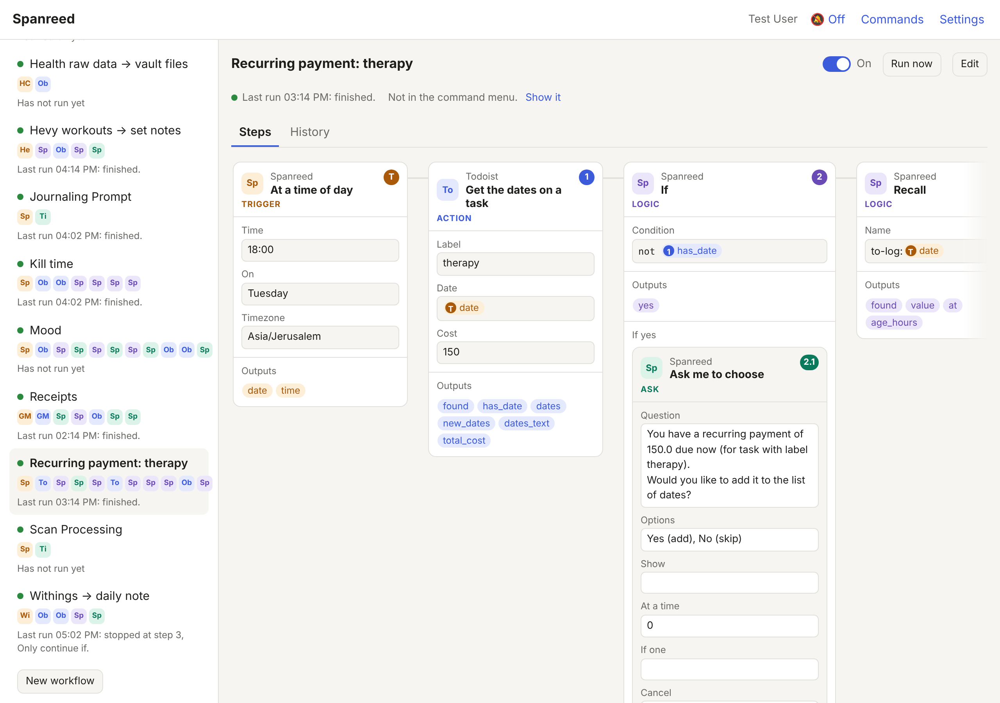

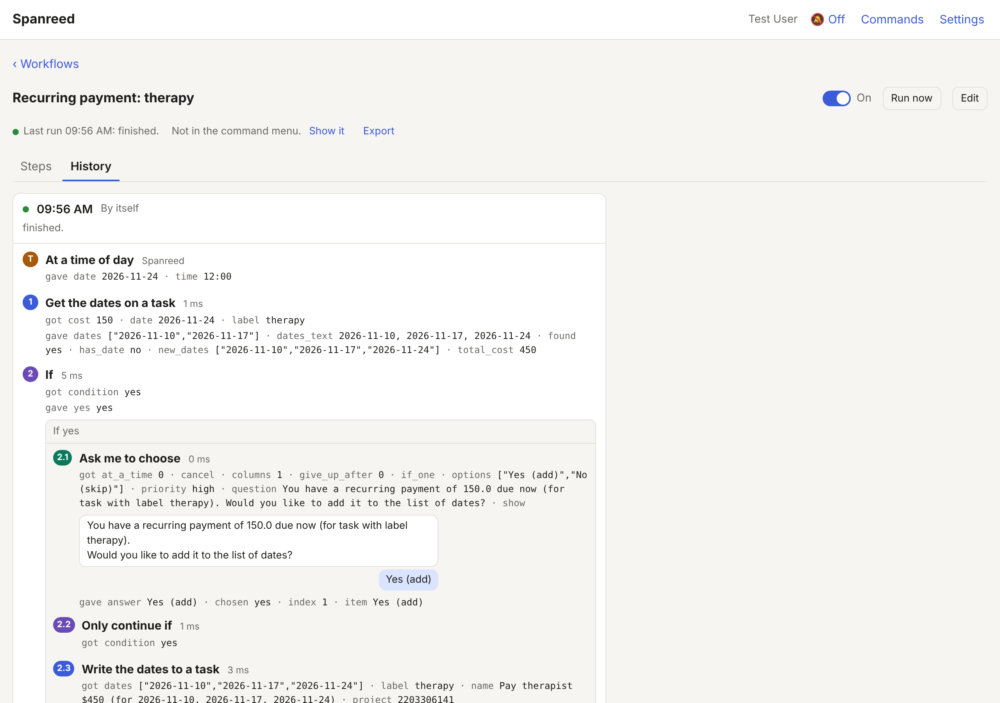

Where the parts of a payment went:

| Was | Is now |
| --- | --- |
| The day of the week, the time and the timezone | **On**, **Time** and **Timezone** of the trigger "At a time of day" |
| The label of the task | **Label** on the two Todoist steps |
| The cost of one time | **Cost** on "Get the dates on a task" |
| The template of the task's name | **Name** on "Write the dates to a task" |
| The project | **Project** on the same step, as its id |
| Asking first | The two steps "Ask me to choose" and "Only continue if". A payment that did not ask has neither |
| The note, and the template of a line | **Path** and **Text** on "Append to note". A payment without a note has no such step |
| The 13 questions that set a payment up in chat | The page of the workflow, or the recipe |
| The date format | Gone. The plugin asked for it and wrote every date as 2026-11-24 |

- **A template keeps the names it used.** The name of the task knew `dates`
  and `total_cost`, and the line of the note knew `date`. A converted
  template starts with a `` for each, and goes on as the user wrote
  it.
- **The note is written for a date that the workflow added, once.** The
  workflow remembers that the note is owed a line from the moment the date
  is on the task, and forgets it when the line is written. So a run that
  fails at the note writes it when it is tried again, without adding the
  date or asking a second time. The plugin told the user to add the line by
  hand.
- **A time that came up during a restart still fires**, within 12 hours. The
  plugin missed it, and the date with it.
- **Text after the dates in the task's comment keeps its place.** The plugin
  put one more empty line before it each week.
- **The question is asked with high priority**, as the plugin asked it.
- **The workflows have no command**, as the plugin had none. Run now on the
  page adds today's date.

`spanreed/plugins/recurring_payments_test_data.py` holds 13 cases and what
the plugin did in each, taken by running it before it was removed. The tests
run the workflow on the same cases and compare.

#### Spanreed Monitor

The plugin told its users two things: that Spanreed started, and what error
Spanreed had kept. It was meant to tell a third: that Obsidian's plugin for
Spanreed had gone quiet. Each is a workflow now.

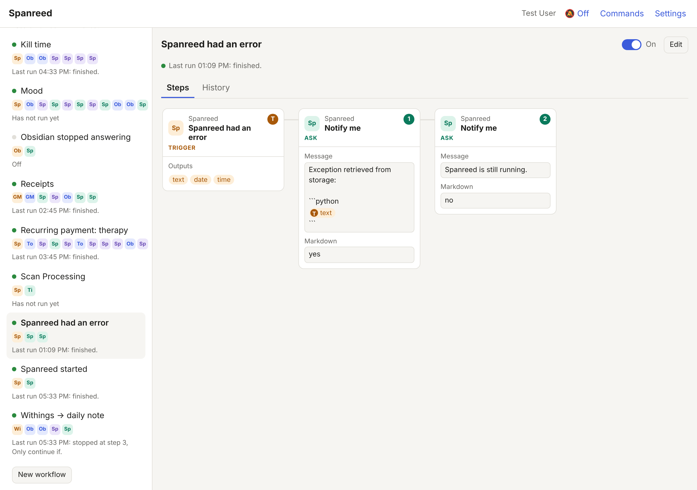

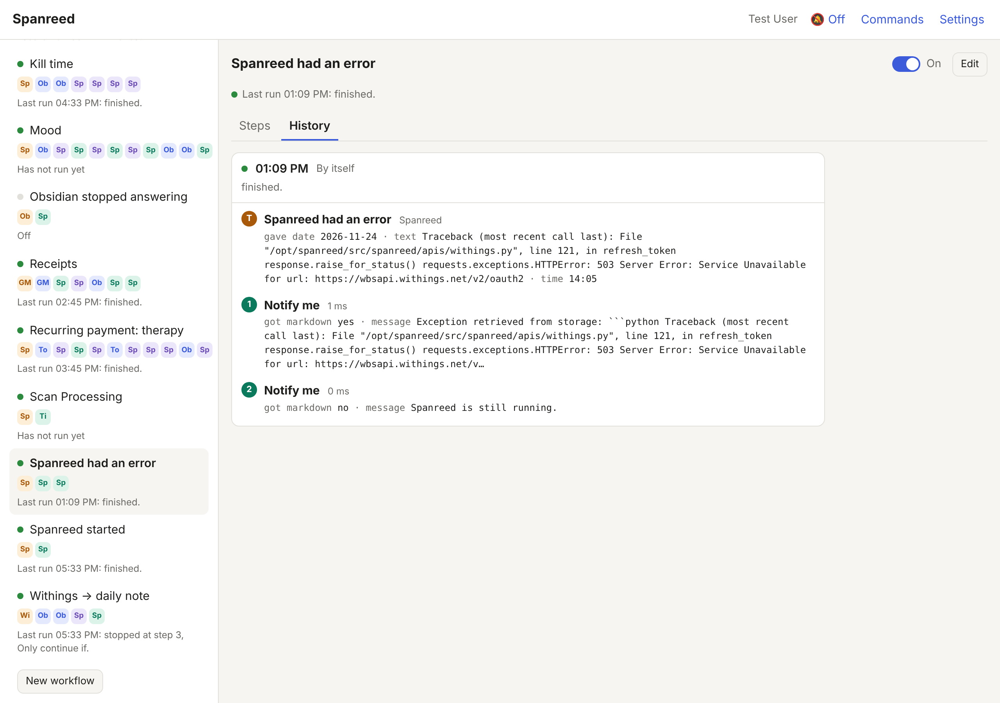

| Was | Is now |
| --- | --- |
| "Spanreed is starting up." | The workflow "Spanreed started": the trigger of that name, and "Notify me" |
| "Exception retrieved from storage: …" and "Spanreed is still running." | The workflow "Spanreed had an error": the trigger of that name, and "Notify me" twice |
| An error of Obsidian's plugin, told as one of Spanreed's | The same, but the Obsidian connector reads what the plugin says, for each of its users |
| "Obsidian plugin watchdog timeout." | The workflow "Obsidian stopped answering", on the trigger "Vault stopped answering". It is installed turned off |
| "Spanreed is shutting down." | Gone |

The errors that Spanreed keeps are the ones that happen outside the run of a
workflow: a command that crashes, a token that cannot be refreshed, an error
of Obsidian's plugin, and what ended the process the last time. They are
written to the log, and their text is put in a list in Redis
(`spanreed/errors.py`). The plugin that runs the engine reads the list, and
fires "Spanreed had an error" for every workflow with that trigger. An error
rarely comes alone, so the ones that wait behind the newest are dropped, as
the plugin dropped them.

The failed run of a workflow is not one of these errors: the engine tells
its user about that itself (see [What the engine does](#what-the-engine-does)).

- **The plugin never said that Obsidian went quiet.** It was written to, a
  minute after the last heartbeat and then every half hour, but the time
  since the last heartbeat was never counted. The trigger counts it, so the
  workflow would speak up every time Obsidian is closed. It starts turned
  off, and the user is told that it is there.

  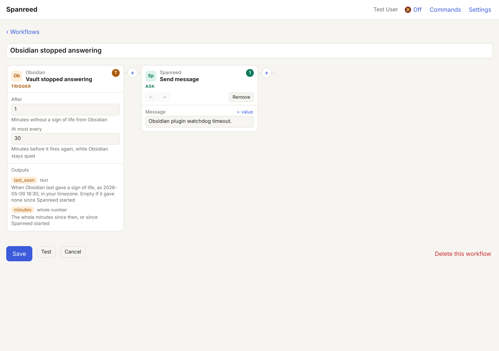

- **Nothing says that Spanreed is shutting down.** A workflow does not run
  while the engine stops. The plugin tried to say it when its task was
  cancelled.
- **Which is told first after a start is open**, that Spanreed started or
  the error that waited from before. They are two workflows. The plugin said
  that it started first.
- **Every workflow with the trigger gets every error.** The plugin's users
  took them from one list, so each error reached one of them.
- **An error of Obsidian's plugin is reported for every user of Obsidian**,
  not only for the users of the monitor. As before, at most one in half an
  hour, none in the first half hour after a start, and not the errors of a
  connection that dropped.

`spanreed/plugins/spanreed_monitor_test_data.py` holds 13 cases and what the
plugin did in each, taken by running it before it was removed. The tests run
the workflows on the same cases and compare.

### Converted: the plugin stays as the connection

The plugin keeps talking to its service. What it did with the data is now a
set of recipes, installed with the settings the user had.

Only the users the plugin has at the first start with the conversion are
converted. A user who registers to the plugin later never had the old
behavior: the setup tells them which recipes to add.

| Plugin | What it still does | Recipes |
| --- | --- | --- |
| Health Connect | Receives the phone's payloads, stores every record, and says which days changed | Health data → daily note · Health raw data → vault files |
| Withings | Holds the login, and publishes the trigger that asks Withings | Withings → daily note |
| Hevy | Holds the API key, and publishes the trigger that asks Hevy | Hevy workouts → set notes |
| Gmail Monitor | Holds the Gmail login, and publishes the Gmail blocks | None: a workflow for each rule the user had |
| Lit Notes | Publishes the search of Google Books | Add book note |
| Timekiller | Publishes three conversations as blocks | Kill time · Journaling Prompt · Mood · Books · Scan Processing |

#### Health Connect


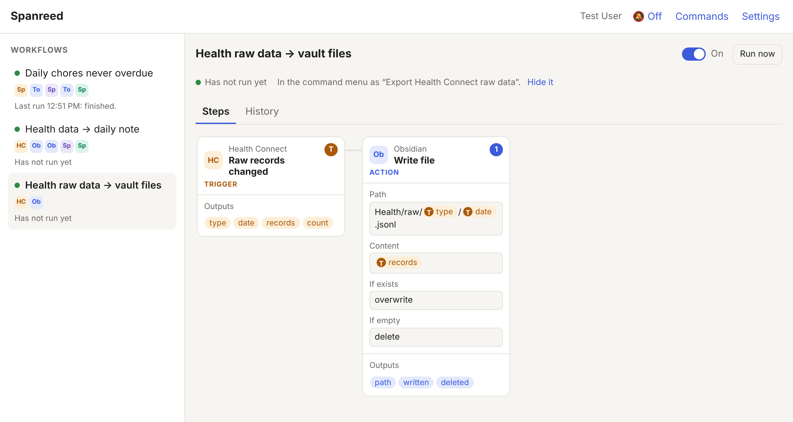

Where the settings of the Health Connect plugin went:

| Was | Is now |
| --- | --- |
| The ten daily note property checkboxes | The rows of **Properties** in "Health data → daily note". A property that was off has no row. |
| Raw data folder | The start of **Path** in "Health raw data → vault files" |
| Sync steps, Sync heart rate, Sync VO2 max | One command, **Sync health data**: today, the last week, or every stored day |
| Export Health Connect raw data | The command of "Health raw data → vault files", under the same name |
| Show Health Connect setup, Delete Health Connect data | Still commands of the plugin |

What differs from the plugin:

- **A day that could not be written is not lost.** The plugin wrote the
  metrics of a payload once and gave up if Obsidian did not answer. The
  workflow keeps the day in its queue until it is written.
- **One message for a day, not one for each kind of metric.** A sync by hand
  says `Logged steps=6227, heart-rate-avg=71 for 2026-05-09.` It names the
  properties it wrote, and says nothing about a day that was up to date.
- **A sync by hand writes what changed.** The plugin's commands wrote every
  value again without reading the note. The note ends up the same.
- **The note of each day gets every metric compared**, not only the kind that
  the payload carried. Only a value that differs is written.

#### Withings

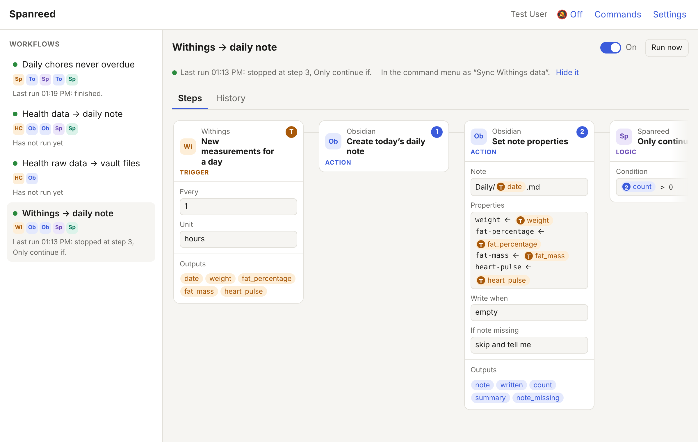

A run of it, under History:


Where the settings of the Withings plugin went:

| Was | Is now |
| --- | --- |
| The four daily note property checkboxes | The rows of **Properties** in "Withings → daily note". A property that was off has no row. |
| Sync Withings data | The command of the workflow, under the same name: today, or the last week |
| Once an hour | **Every** and **Unit** of the trigger |

What stays as it was: a value goes only into a property that is empty
(**Write when**: empty), so a value corrected by hand is never replaced. The
user is told about what was written in the background too, and about a day
that has no daily note.

What differs from the plugin:

- **One message for a day, not one for each value:** `Logged weight=80.5,
  fat-percentage=20.1 for 2026-05-09.`
- **Yesterday is asked for too.** The plugin asked for today only, so a
  measurement that reached Withings after midnight was never written.
- **A day that could not be written is tried again.** While Obsidian does not
  answer, the day is not remembered as done, and the next poll finds it.
- **An unchanged day does not run again.** The plugin read the note every
  hour. The workflow runs when the day's measurements differ from the last
  time it ran for the day. So a value that was deleted from the note by hand
  comes back with the next new measurement or a sync by hand, not within the
  hour.

#### Hevy


Where the settings and the state of the Hevy plugin went:

| Was | Is now |
| --- | --- |
| Vault folder | The start of **Path** in "Write note" |
| The layout of a set note, in Python | The **Path**, **Properties** and **Body** of "Write note" |
| Sync Hevy workouts, Re-create Hevy data | One command, **Sync Hevy workouts**: new workouts, a date, a workout id, or all workouts |
| Once an hour | **Every** and **Unit** of the trigger |
| How far the polls had got, and which workouts were written | The trigger's cursor and memory, carried over, so no workout is written or announced twice |

The notes are the ones the plugin wrote: the same paths, the same properties
in the same order, the same line of text. `spanreed/apis/hevy_test_data.py`
holds a workout and what the plugin wrote for it, and the tests compare.

What differs from the plugin:

- **A property with no value is left out.** The plugin wrote `weight_kg` and
  `reps` as empty properties for a set that has none, such as a plank. A note
  that is there already is not changed.
- **A workout that could not be written is tried again sooner.** The plugin
  waited an hour. The workflow tries five times within about 15 minutes, tells
  the user once, and then tries with each poll.
- **Writing a date or a workout again says less.** The plugin ended with the
  number of notes it wrote. The workflow ends with `done. The run ended at
  step 2, Only continue if.`, because a workout that was written before is not
  announced again. History shows each note.
- **Writing all workouts again is one run for each workout**, and History
  keeps the last 100.

#### Gmail Monitor

Gmail Monitor held rules: a filter and a list of actions each, made and
changed in chat. Each rule a user had becomes a workflow of its own, named
after the rule. There is no recipe: `spanreed/plugins/gmail_rules.py` builds
the workflow from the rule.


Where the parts of a rule went:

| Was | Is now |
| --- | --- |
| The filter of a rule | **Sender**, **Subject**, **Body** and **Attachments** of the trigger "New email" |
| Whether the rule was on | Whether the workflow is on |
| The check interval, one for all rules | **Every** and **Unit** of each trigger |
| When the plugin last looked, and the emails it had checked | Each trigger's cursor and memory, carried over, so no email is acted on twice |
| Manage Email Rules | The editor |
| Test Email Rule | **Test** in the editor, and **Run now** |
| Run rules on inbox | **Run now** on a workflow: new emails, the inbox, or the starred emails in it |
| Email Monitor Status | The list of workflows, and History |

What each type of action became:

| Action | Steps |
| --- | --- |
| `telegram_notification` | Send message |
| `download_attachment` | Get attachments → Send message (if there are none) → For each: Send file, Send message |
| `save_attachment_to_vault` | Get attachments → Send message (if there are none) → For each: Write file, Send message (saved, or was there already) |
| `download_link` | Find links → Send message (if there are none) → For each: Download a file, Send message (if it is no file), Only continue if it is one, Send file, Send message |
| `save_link_to_vault` | Find links → Send message (if there are none) → For each: Download a file, Send message (if it is no file), Only continue if it is one, Write file, Send message |

A rule's file name (`{date} {sender} {original}`) is the path of "Write file",
with the values of the email and the file in place of the placeholders.

`spanreed/plugins/gmail_rules_test_data.py` holds an email and what the rule
actions said and wrote for it, taken by running them before they were
removed. The tests run the workflow of each rule and compare.

What differs from the plugin:

- **Messages are plain text.** The plugin sent the labels of a notification
  (From, Subject) in bold.
- **A workflow's command is not in the command menu** unless it is shown: the
  plugin had one command for all rules.
- **A step that fails is tried again.** An action that failed said so and the
  rule went on with the next one. A workflow runs again from its first step,
  five times, then tells the user, and the email is found again by a later
  poll. With **If exists** `skip`, a file that an earlier try saved is left.
- **An attachment is sent under a name that is safe as a file name**, and one
  with no name as `attachment-2`. The plugin sent the name as it was.
- **A downloaded link says less.** The plugin said which link it was at, how
  large the file was and that it was done. The workflow sends the file and
  one message.
- **Downloads go to public addresses only** (see Files above).
- **Mail is asked for by the second**, not by date (see Gmail above).
- **A rule that the plugin could not run** (a pattern that is no regular
  expression) becomes a workflow that is off and says what is wrong.

#### Lit Notes

Lit Notes had one command, "Add book note": a conversation that ends with a
note for a book. It is the recipe "Add book note" now, and the plugin
publishes the search.

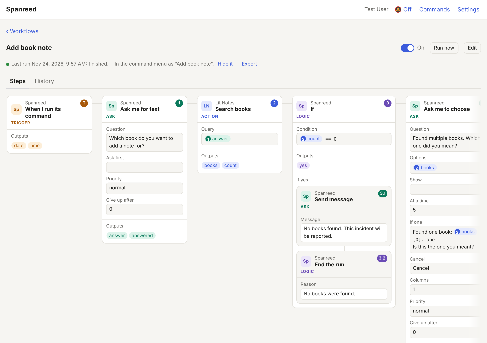


Where the parts of the plugin went:

| Was | Is now |
| --- | --- |
| The command Add book note | The command of the workflow, with the same name |
| The folder of the notes | The start of **Path** on "Append to note" |
| The template of the title | The rest of **Path**, before `.md` |
| The template of the note | **Text** on "Append to note" |
| The vault name | Gone. It was for a link that made the note when there was no vault plugin |

- **A template keeps the names it used.** The plugin gave a template `book`,
  `recommended_by` and `free_text`. In the workflow these are values of the
  steps that asked: `book.item`, `recommended_by.answers`,
  `free_text.answer`. A converted template starts with three ``
  that give them their old names, and goes on as the user wrote it. The
  recipe as it ships uses the new names.
- **A name that is not there fails the step.** The plugin left out what a
  template named that a book does not have. Templates of workflows do not.
  The conversion tries the user's templates on a made-up book, and tells the
  user if one would fail. A template that names something no step gives
  (`{{ today }}`) keeps the workflow from running at all: it is stored as it
  is, says why on its page, and has no command until the template is changed.
- **A title with a dot keeps all of it.** The plugin cut the name of the note
  at the last dot of the title: "Mr. Fox" became `Mr.md`.
- **"Show more" is offered while there is more.** The plugin offered it under
  the last books too, and then showed none.
- **A line of authors has its spaces.** "Terry Pratchett and Neil Gaiman",
  where the plugin wrote "Terry Pratchettand Neil Gaiman".
- **If Obsidian does not answer, the run fails** at "Append to note" and says
  so. The answers are in the history of the run. The plugin sent a link that
  made the note.

`spanreed/plugins/litnotes_test_data.py` holds six conversations and what the
plugin asked, said and wrote in each, taken by running it before it was
removed. The tests run the workflow on the same answers and compare.

#### Timekiller

Timekiller pushed, every hour or two during the day, one of four things
picked at random: a journaling prompt, a question about the mood of the day,
a check on the books being read, or a scan that waits for a name. Its
command, "Kill time", let the user pick.

It is five workflows now. "Kill time" does the picking, and runs one of the
other four:

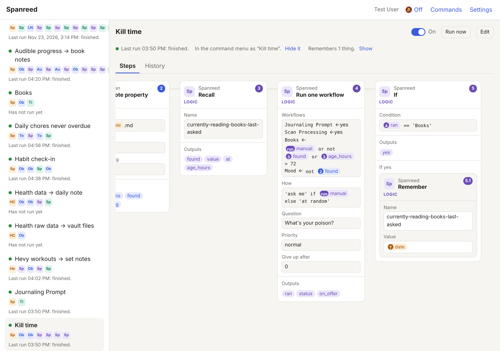


| Workflow | Is | What can be changed |
| --- | --- | --- |
| Kill time | The schedule, at random times between 08:00 and 22:00, and "Run one workflow" | How often, the hours, which of the four are on offer and when |
| Journaling Prompt | One block with the conversation inside | The 24 prompts, the note, the heading |
| Mood | Drawn in steps: read the property, ask, write | The questions, the feelings, the properties |
| Books | "Query Dataview", then one block with the conversation inside | The query for the notes of the books |
| Scan Processing | One block with the conversation inside | The folder |

The three blocks are the plugin's conversations as they were: each goes
back on itself (another prompt, another book, another name for a file),
which steps on a page do not do. Mood only moves forward, so it is drawn:

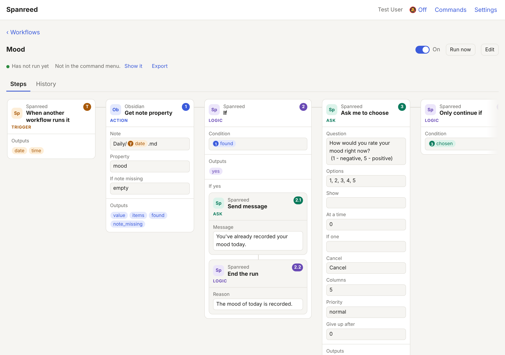

A push in the history of the part that ran, with the conversation of the
block:

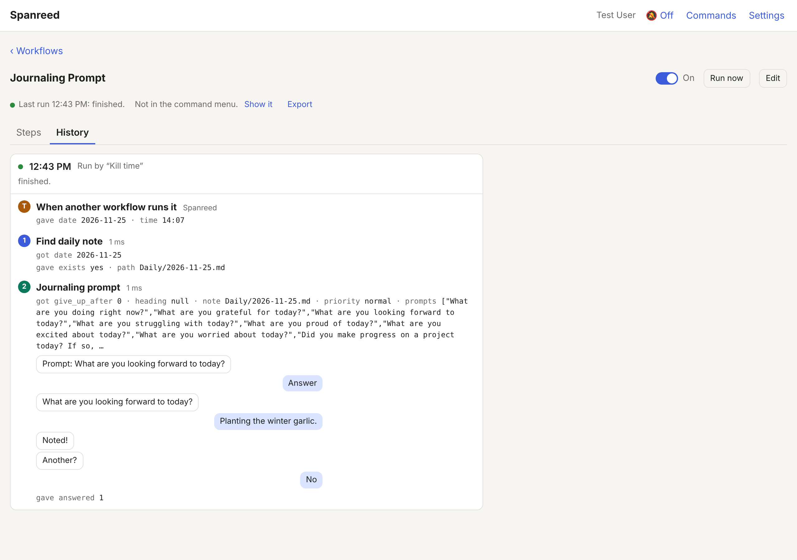

Where the rest of the plugin went:

| Was | Is now |
| --- | --- |
| Kill time, the command | The command of "Kill time". By hand it asks "What's your poison?"; by itself it picks at random |
| Set journal heading | **Heading** on the step of "Journaling Prompt" |
| Clear skipped scans | The page of "Scan Processing": what it remembers, and Forget, for one scan or for all |
| Books at most every three days | A row of "Run one workflow": `run.manual or not books.found or books.age_hours > 72`. "Kill time" remembers when it ran "Books" |
| Mood once a day | A row: `not mood.found`, from the property of today's note |
| The folder of the scans, written into the code | **Folder** on the step of "Scan Processing" |

The four parts have the trigger "When another workflow runs it", and their
commands are hidden, so the command menu has the one entry it had. Turning a
part off takes it out of the picking.

- **The hours are in the user's timezone.** The plugin used the server's
  clock.
- **A restart does not push.** The plugin pushed right after every start.
  "At random times" keeps when the next push is due.
- **A feeling that was picked is not offered again**, and "stressed" is in
  the list once. The plugin had it twice, and wrote a feeling as often as it
  was picked.
- **A finish date that is not a date is asked for again.** The plugin failed
  on it.
- **A push that is taken over by another conversation is dropped**, as the
  plugin did, and "Kill time" then does not remember that the books were
  asked about.
- **Installing only "Kill time" from the recipes does nothing**: it runs the
  other four by their names. A user of the plugin gets all five.

`spanreed/plugins/timekiller_test_data.py` holds 31 cases and what the plugin
did in each, taken by running it before it was changed. The tests run the
workflows on the same cases and compare.
