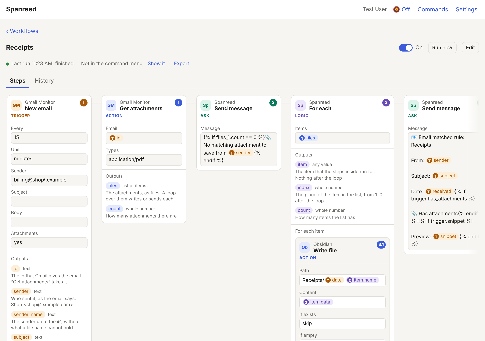
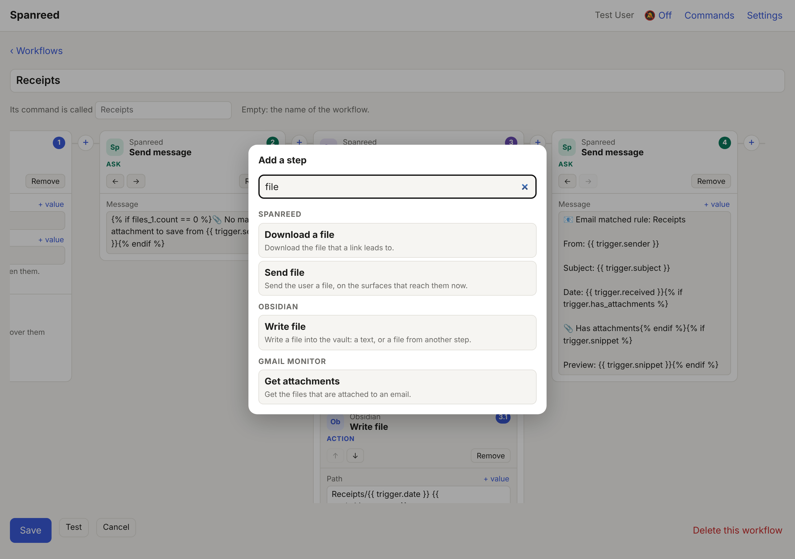
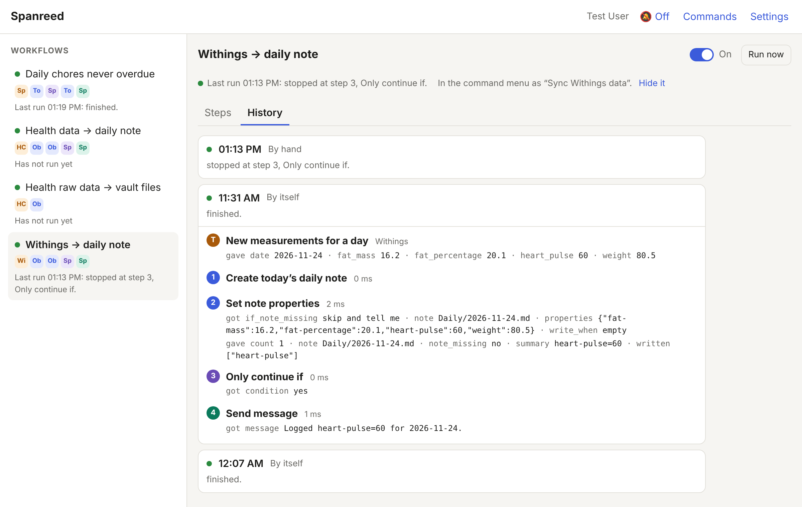
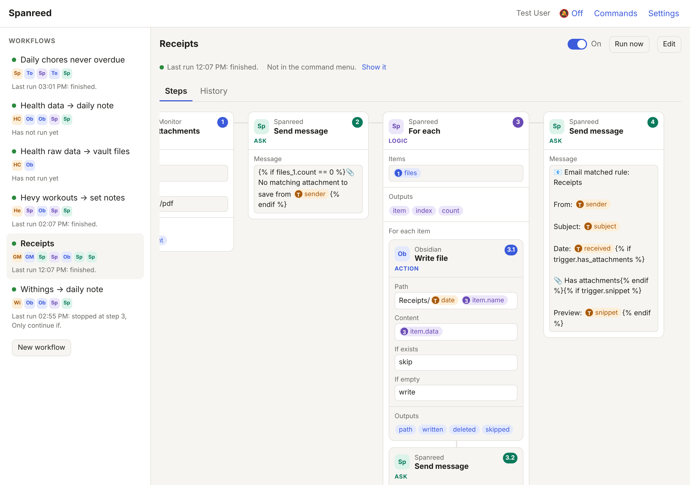
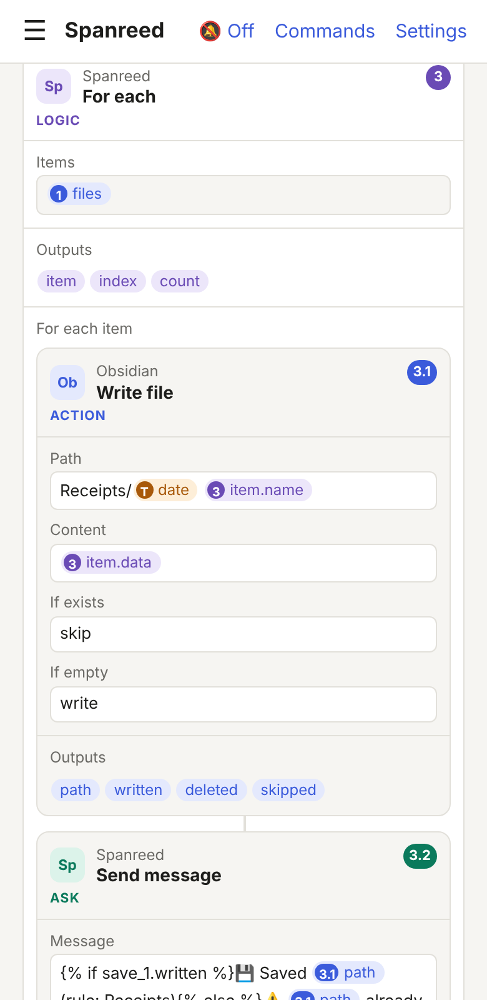

# Workflows

A workflow is an automation that a user owns: one trigger and an ordered list
of steps. Plugins publish the blocks that triggers and steps are made of, and
one engine runs every workflow.

This replaces behavior that used to be written into a plugin. A plugin decided
when it ran, what it did and whether it told you. A workflow keeps those apart,
so that each can be changed without code.

A workflow comes from a recipe, or is built in the web UI from a trigger and
the blocks of the user's plugins. The web UI shows a workflow's steps and the
history of its runs, turns it on and off, runs it and edits it (see
[web-ui.md](web-ui.md#workflows)). The chat command **Manage workflows**
lists, switches and runs workflows, and also adds one from a recipe and
deletes one. Editing is in the web UI only.

## The parts

| Part | What it is | Where |
| --- | --- | --- |
| Block | A unit with typed inputs and outputs. An `Action` is a step. A `Trigger` starts runs. | `spanreed/workflows/blocks.py` |
| Workflow | A trigger, steps, a name, and whether it is on. Stored as JSON for each user. | `spanreed/workflows/model.py` |
| Run | One execution, for one event of the trigger. Its trace holds what each step received and returned. | `spanreed/workflows/engine.py` |
| Recipe | A workflow that ships with Spanreed. Installing one copies it to the user. | `spanreed/workflows/recipes/*.json` |

`WorkflowsPlugin` (`spanreed/plugins/workflows.py`) is a core plugin, like User
Profile: every user is registered to it. It builds the block registry from
`Plugin.blocks()` of every loaded plugin, starts the engine, and owns **Manage
workflows**.

## A workflow as JSON

This is the recipe that replaced the Todoist No Overdue plugin:

```json
{
  "id": "todoist-no-overdue",
  "name": "Daily chores never overdue",
  "requires": ["todoist"],
  "command_hidden": true,
  "trigger": {"block": "core.schedule", "params": {"every": 4, "unit": "hours"}},
  "steps": [
    {"id": "find", "block": "todoist.find-tasks",
     "inputs": {"label": "spanreed/no-overdue", "due": "overdue"}},
    {"id": "any", "block": "core.continue-if",
     "inputs": {"condition": "{{ find.count > 0 }}"}},
    {"id": "move", "block": "todoist.set-due-date",
     "inputs": {"tasks": "{{ find.tasks }}", "due": "today"}},
    {"id": "tell", "block": "core.send-message",
     "inputs": {"message": "Updated {{ find.count }} overdue tasks to today."}}
  ]
}
```

A step's inputs can refer to what came before it, in Jinja syntax:

- `trigger`: the outputs of the trigger's event.
- `run`: the run itself. `{{ run.manual }}` is true for a run started by hand.
- The `id` of an earlier step: its outputs.

A text with a template in it gives text. A text that is one expression and
nothing else gives the value itself, so `"{{ find.tasks }}"` is a list and
`"{{ find.count > 0 }}"` is yes or no. Templates run in Jinja's sandbox, and a
name that does not exist is an error.

A workflow is checked when it is installed and when the engine starts: every
block must exist, the inputs must fit the block, and a template can only refer
to the trigger, the run or an earlier step. A workflow with a problem is not
started, and **Manage workflows** says what the problem is.

### Steps inside a step

A step whose block is a loop holds steps of its own. `core.for-each` runs
them once for each item of a list. This is from the recipe that writes a note
for each set of a Hevy workout:

```json
{"id": "each", "block": "core.for-each",
 "inputs": {"items": "{{ trigger.sets }}"},
 "steps": [
   {"id": "note", "block": "obsidian.write-note",
    "inputs": {
      "path": "Fitness/Sets/{{ trigger.folder }}/{{ each.item.note_name }}.md",
      "properties": {"exercise": "{{ each.item.exercise }}", "reps": "{{ each.item.reps }}"},
      "body": "{{ each.item.summary }}"}}
 ]}
```

- Inside the loop, the id of the loop's step gives the item the steps run
  for, and its place: `{{ each.item }}`, `{{ each.index }}` (from 1) and
  `{{ each.count }}`. After the loop it gives `{{ each.count }}`.
- The steps inside can also refer to the trigger, the run, the steps before
  the loop and each other. A step after the loop cannot refer to a step
  inside it.
- Ids are unique in the whole workflow. The engine and the page number the
  steps inside step 2 as 2.1, 2.2.
- "Only continue if" inside a loop ends the steps for that item, and the loop
  goes on with the next one.
- A step inside that fails makes the loop fail, and with it the run: `failed
  at step 1, For each: Item 3 of 5, Write note: …`. The run is tried again
  from its first step, so the items before are done again.
- The trace keeps the first 50 rounds of a loop, and the one that failed.

## Blocks

| Block | Kind | Published by |
| --- | --- | --- |
| `core.schedule` On a schedule | trigger | Workflows |
| `core.continue-if` Only continue if | logic | Workflows |
| `core.for-each` For each | logic | Workflows |
| `core.send-message` Send message | ask | Workflows |
| `core.send-file` Send file | ask | Workflows |
| `core.download-file` Download a file | action | Workflows |
| `todoist.find-tasks` Find tasks | action | Todoist |
| `todoist.set-due-date` Set due date | action | Todoist |
| `obsidian.create-daily-note` Create today's daily note | action | Obsidian |
| `obsidian.set-note-properties` Set note properties | action | Obsidian |
| `obsidian.write-file` Write file | action | Obsidian |
| `obsidian.write-note` Write note | action | Obsidian |
| `health-connect.day-changed` A day's data changed | trigger | Health Connect |
| `health-connect.raw-records-changed` Raw records changed | trigger | Health Connect |
| `withings.new-measurements` New measurements for a day | trigger | Withings |
| `hevy.new-workout` New workout | trigger | Hevy |
| `gmail.new-email` New email | trigger | Gmail Monitor |
| `gmail.get-attachments` Get attachments | action | Gmail Monitor |
| `gmail.find-links` Find links | action | Gmail Monitor |

More arrive with each plugin whose behavior becomes a recipe.

### Files

A file is a value like any other: a step that gets files gives them as a
list, and a step that takes a file reads its `data`. A file has a `name`
that is safe to write it under, its `stem` and `extension`, its `type` and
its `size`. A trace shows the size of the data, not the data.

- `gmail.get-attachments` gives the attachments of an email as `files`.
- `core.download-file` gives the file that a link leads to. It follows HTTP
  redirects and pages that only send the browser on, and it fetches from
  public addresses only: each address on the way is checked. A link that
  does not lead to a file does not fail the step: `ok` is no and `problem`
  says why (a web page, a picture, too large, HTTP 404). The step fails, and
  the run is tried again, if the server does not answer or has an error.
- `obsidian.write-file` takes a text or the data of a file as its content.
  **If exists**: `skip` leaves a file that is there and sets `skipped`.
- `core.send-file` sends a file to the user.

This saves the PDF attachments of an email into the vault, and says for each
whether it was saved or was there already:



```json
{"id": "files", "block": "gmail.get-attachments", "inputs": {"email": "{{ trigger.id }}"}},
{"id": "each", "block": "core.for-each", "inputs": {"items": "{{ files.files }}"},
 "steps": [
   {"id": "save", "block": "obsidian.write-file",
    "inputs": {"path": "Receipts/{{ trigger.date }} {{ each.item.name }}",
               "content": "{{ each.item.data }}", "if_exists": "skip"}},
   {"id": "told", "block": "core.send-message",
    "inputs": {"message": "💾 Saved {{ save.path }}⚠️ {{ save.path }} already exists; skipped."}}
 ]}
```

The same workflow on a phone, and the blocks for files in the editor's list:




A message that comes out empty is not sent. So a message that is all inside
`` is sent only when the condition holds, which stands in for a
branch until there are branches.

### Gmail

`gmail.new-email` asks Gmail at its interval (15 minutes unless changed) for
the emails that came since its last poll, and fires for each one that matches
its filter: patterns for the sender, the subject and the body, and whether
the email has attachments. A pattern is a regular expression, searched
without regard to case.

- An email fires once for a workflow.
- The first poll of a workflow looks back an hour.
- A poll asks Gmail by the second (`after:1778320800`). Gmail takes a date
  (`after:2026/05/09`) as midnight in Pacific time, whatever the timezone of
  the user.
- If the Gmail login is no longer accepted, the poll sends the user a link to
  log in again, once, and keeps its place.
- By hand, the workflow runs for the new emails, or for every email in the
  inbox (or the starred ones) that matches, up to 200, after asking.

### Writing a block

An action names its input and output dataclasses as type arguments:

```python
@dataclass
class FindTasksInput:
    label: str
    due: Literal["any", "overdue"] = "any"

@dataclass
class FindTasksOutput:
    tasks: list[Any]
    count: int

class FindTasks(Action[FindTasksInput, FindTasksOutput]):
    id = "todoist.find-tasks"      # stable: stored workflows refer to it
    title = "Find tasks"

    async def run(self, ctx: StepContext, inputs: FindTasksInput) -> FindTasksOutput:
        todoist = await Todoist.for_user(ctx.user)
        ...
```

The plugin returns it from `blocks()`:

```python
class TodoistPlugin(Plugin[UserConfig]):
    def blocks(self) -> list[Block]:
        return todoist_blocks()
```

- The input values are checked against the dataclass with
  `spanreed.config_form`, the check that the settings form uses.
- A user's workflow can use a plugin's blocks while the user is registered to
  that plugin. Otherwise the step fails and says which plugin to set up.
- Raise `StopRun` to end the run at this step without failing it. Any other
  exception fails the run.
- A failed run is tried again from its first step, so a block must be safe to
  repeat.

A block that holds steps is a `Loop`: an action with a `rounds` method, which
returns what the steps inside see as the loop's outputs, once for each time
they run. `run` returns the outputs for the steps after the loop.

### Triggers

A trigger names its parameters and its event, and yields an event each time
the workflow should run. The fields of the event are its outputs.

```python
class Schedule(Trigger[Repeat, Tick]):
    id = "core.schedule"
    title = "On a schedule"
    Manual = NoQuestion

    async def events(self, ctx, params) -> AsyncIterator[Tick]:
        while True:
            ...
            yield tick
            await ctx.state.set("last_fired", ...)   # after the run is over
```

The engine runs the workflow for an event before it asks for the next one, so
the code after a `yield` runs when that run is over. The `yield` gives back
whether the run worked. `ctx.state` keeps small values, such as a cursor, for
each workflow across restarts.

#### Triggers that a plugin feeds

A `PushTrigger` is for a plugin that learns of changes itself, as Health
Connect does when the phone posts a payload. The plugin says what changed,
with one key for each thing:

```python
await DayChanged.emit(user, ["2026-05-09"])
```

The key waits in a queue, in Redis, for every workflow of the user that is on
and uses the trigger. The trigger turns a key into an event when the workflow
is ready to run for it:

```python
class DayChanged(PushTrigger[NoParams, DayMetrics]):
    id = "health-connect.day-changed"

    async def event_for(self, ctx, params, key) -> DayMetrics | None:
        return await day_metrics(ctx.user, datetime.date.fromisoformat(key))
```

- The event is built when the run starts, so it holds what is stored at that
  moment, and a key that is put twice before its run gives one run.
- A key leaves the queue when its run worked. A restart in the middle of a
  run finds the key again.
- If the run failed every time it was tried, the key goes behind the others
  and is tried again after them. Nothing is dropped while Obsidian is closed.
- A key that is put again during its own run stays, and gives another run.
- A workflow that is off gets no keys. It does not collect what it missed;
  a run by hand over a range fills that in.

#### Triggers that poll a service

A `PollTrigger` is for a service that has to be asked, such as Withings. Its
parameters are `Repeat` (every 1 hour, for example), and `poll` returns an
event for each thing the service has now:

```python
class NewMeasurements(PollTrigger[Repeat, DayMeasurements]):
    id = "withings.new-measurements"

    async def poll(self, ctx, params, cursor) -> Poll[DayMeasurements]:
        today = datetime.date.today()
        yesterday = today - datetime.timedelta(days=1)
        return Poll(events=await measurements_of(ctx.user, yesterday, today))

    def key(self, event) -> str:        # what the event is about
        return event.date

    def version(self, event) -> str:    # what state that is in
        return digest(event)
```

A poll usually finds what earlier polls found too. The trigger remembers
what the workflow ran for, and leaves those events out:

- `key` names the thing an event is about. By default the workflow runs once
  for a key.
- `version` makes it run again when the thing changed. `digest(event)`
  changes when any field of the event does.
- An event is remembered when its run worked. If the run failed every time
  it was tried, the next poll gives the event again. So a poll has to keep
  returning a thing until then: Withings is asked for yesterday too.
- A poll can return a `cursor` for a service that can be asked for what is
  new since a point. It is kept, and handed to the next poll, once every run
  of the poll worked.
- The first poll of a new workflow is at once. After a restart the next poll
  waits for the rest of the interval, as a schedule does.
- The trigger remembers its last 1000 keys (`remembers`).
- `new_events` polls now and returns what the workflow has not run for, for a
  trigger whose manual run checks at once. A run by hand that worked is
  remembered, so the next poll does not run for the same thing.
- `PollTrigger.start_from` hands a trigger that never polled a cursor and the
  keys that were handled before it existed. The Hevy conversion uses it.

`Manual` says whether the user can start a run by hand:

- `None`: no.
- `NoQuestion`: yes, and nothing is asked.
- A dataclass: yes, after the user answers a question for each field. A field
  that is a `Literal` is a choice, and a field that is a `str` is a text.
  `manual_events` gets the answers and returns the events to run.

A question can depend on an earlier answer, and a trigger can refuse an
answer:

```python
@dataclass
class WorkoutChoice:
    which: Literal["New workouts", "A specific date", "A workout ID", "All workouts"] = field(
        metadata={"prompt": "Write Hevy workouts for…"}
    )
    date: str = field(default="", metadata={
        "prompt": "Enter the date (YYYY-MM-DD):",
        "ask_if": {"which": "A specific date"},
    })
```

- `ask_if` names the answers that a question waits for. A question that is not
  asked leaves its field at its default.
- `manual_events` raises `ManualError` to tell the user why there is nothing
  to run: `No workout found on 2026-05-09.`
- `manual_run_done` tells the trigger how each run by hand went.

`core.schedule` keeps the time of its last event. After a restart it fires at
once if it is due and waits for the rest of its interval if it is not. A new
workflow fires at once.

## Commands

A workflow whose trigger can be started by hand is a command, on every
surface, for the user who owns it. The command:

- has the id `workflow.<workflow id>`, so that renaming the workflow does not
  change it for surfaces that remember commands;
- is named after the workflow, unless the workflow has a `command_name`;
- is on by default, and `command_hidden` takes it out of the menu. A recipe
  that replaces a plugin ships with the commands that the plugin had, so
  "Daily chores never overdue" ships hidden;
- goes away while the workflow is off.

A run started by hand happens inside the command's flow, so its messages stay
on the surface it was started from. It is not tried again if it fails, and it
ends with one line that says how it went: `Daily chores never overdue: done.
The run ended at step 2, Only continue if.` Several runs are counted: `3 runs.
1 finished, 2 ended early, 0 failed.` A run that a block ended on purpose did
what it was asked to, so the line does not call it stopped.

`spanreed.interaction.commands` can now register a command for one user, and
surfaces check a command with `get_command_for_user` before they run it.

## What the engine does

- **One event, one run. One run at a time for each workflow.**
- **A failed run is tried again** for the same event: five times in all, with
  a pause of 60 seconds that doubles. After the last try the user is told
  once, and not again until a run works. The workflow stays on.
- **A workflow that keeps failing is tried twice an hour.** After those five
  tries, each event gets one try, no sooner than 30 minutes after the last
  failure, until a run works. A service that is down for a night is not asked
  hundreds of times.
- **A trigger that fails is started again** after a pause that doubles from 60
  seconds to 30 minutes, like a plugin that crashed.
- **Telegram flood control pauses the step**, not the run: the step waits for
  the ban plus a random extra and is tried again, up to three times. A run
  started by hand does not wait.
- **Values stay out of the log.** The engine logs which step ran and how it
  ended. A step's inputs and outputs are kept only in the run's trace.
- **Turning a workflow on or off takes effect at once.**

Not there yet: branches, and blocks that ask the user a question. A question
a run is waiting on would not survive a restart.

## Editing

The page edits a workflow's name, the text of its command, the inputs of its
trigger and steps, and which steps there are and in what order.
`spanreed/workflows/editing.py` moves a workflow between what is stored and
what the forms hold.

Every input is edited as text, because any input can hold a template where
its type asks for a number or a list. There are three controls:

| Control | For | What is stored |
| --- | --- | --- |
| Text | Texts, numbers, yes/no, lists, anything else | A text with a template is stored as it is. Without one, it becomes what the input asks for: `4`, `yes`, `["a", "b"]`. |
| Choice | A `Literal` | The choice |
| Rows | A mapping, such as the properties to set | A name and a value for each row, in the order of the rows |

The value of a row, and an input of any type, keeps a text that reads as a
number, `true`, `false`, `null` or a list as that value, so `5` is the number
five. A text in quotes, `"5"`, is the text. Anything else is a text.

Saving sends the whole workflow to `PUT /app/api/workflows/<id>`. Nothing is
stored unless every value fits its input and the engine can run the result
(see `model.problems`): the answer lists what has to change, as the page
shows it. A saved edit takes effect at once: the trigger starts again with
the new values and keeps what it remembers.

A card gets the list of values it can use from the cards before it. A step
inside a loop is also offered the fields of the loop's items, when the loop
goes over an output whose items are known, such as the sets of a workout.

What a workflow can be made of comes from `GET /app/api/workflows/catalog`:
every block with the card of a new step of it, and every recipe. A block of a
plugin that the user is not registered to is listed and cannot be picked, and
so is a recipe that needs such a plugin.

- **A new step** gets an id after its block: `write_note`, then
  `write_note_2`. Ids are not shown and cannot be changed. A step that is
  removed or moved while a later step still refers to it is a problem that
  Save reports.
- **A new workflow** is made with `POST /app/api/workflows`, from a recipe or
  with only a trigger. One that starts with only a trigger is off, so that
  its trigger does not start to count things as done before there are steps.
- **The trigger of a workflow cannot be changed.** What a trigger remembers
  (a cursor, the things it ran for) belongs to that trigger.
- **Deleting** a workflow (`DELETE /app/api/workflows/<id>`) deletes its
  history and what its trigger remembers.

### Testing

`POST /app/api/workflows/<id>/test` runs a workflow once as the editor holds
it, without storing it, and returns the trace.

- **The run is real.** The steps do what they do. It is not tried again if it
  fails, `{{ run.manual }}` is true in it, and its trace is kept in the
  history with `test` set.
- **It runs for the last event**, the one the stored workflow last ran for.
  The engine keeps that event whole for each workflow: a trace keeps only the
  start of a long text or list, and a test that ran for a trace would write
  the shortened value. For a trigger whose `Manual` is `NoQuestion` it can
  also run for an event that the trigger makes at that moment.
- **The kept event reads like the original** in templates: `{{ trigger.date
  }}`, `{{ each.item.reps }}`. A block gets plain values from it, not the
  objects the trigger made.

### What a step writes

A block can name what a step of it writes that another step could write too:

```python
class SetNoteProperties(Action[...]):
    def writes(self, inputs: dict[str, Any]) -> list[str]:
        return [f"the property “{name}” of {inputs['note']}" for name in inputs["properties"]]
```

`inputs` are the stored inputs, templates and all. Two steps that give the
same name write the same thing. The page says so on a workflow when another
workflow of the user that is on gives a name that it gives too. It is not a
problem: both run.

## Redis

| Key | Holds |
| --- | --- |
| `workflows:user_id={id}` | Set of the user's workflow ids |
| `workflows:workflow:{id}` | The workflow, as JSON |
| `workflows:workflow:{id}:state` | Hash of what its trigger remembers: when it last fired or polled, a cursor, the keys it ran for |
| `workflows:workflow:{id}:runs` | The traces of its last 100 runs, newest first. Dropped 30 days after the last run. |
| `workflows:workflow:{id}:last_event` | The event it last ran for, whole, with the time of the run. Dropped 30 days after the last run. |
| `workflows:workflow:{id}:queue` | List of the keys it still has to run for, oldest first |
| `workflows:workflow:{id}:queued` | Hash of those keys, each with a token that changes when the key is put again |
| `workflows:converted:{plugin}` | Set of the users whose use of a plugin was converted to recipes |
| `workflows:to-convert:{plugin}` | JSON list of the users the plugin had when it became recipes, and who are not converted yet |

## Plugins that became recipes

`spanreed/workflows/migrations.py` moves the users, once each, at startup. A
user never has the old behavior and the new one, and doing it again changes
nothing.

### Retired: the whole plugin is a recipe

The plugin is deleted from the code. Each user who is still registered to it
gets the recipe and is told so, and the registration is dropped.

| Plugin | Recipe |
| --- | --- |
| Todoist No Overdue | Daily chores never overdue |

The schedule differs from the plugin in one way: the plugin ran at every
start of Spanreed and then every 4 hours, and the recipe runs every 4 hours
whether or not Spanreed was restarted in between.

### Converted: the plugin stays as the connection

The plugin keeps talking to its service. What it did with the data is now a
set of recipes, installed with the settings the user had.

Only the users the plugin has at the first start with the conversion are
converted. A user who registers to the plugin later never had the old
behavior: the setup tells them which recipes to add.

| Plugin | What it still does | Recipes |
| --- | --- | --- |
| Health Connect | Receives the phone's payloads, stores every record, and says which days changed | Health data → daily note · Health raw data → vault files |
| Withings | Holds the login, and publishes the trigger that asks Withings | Withings → daily note |
| Hevy | Holds the API key, and publishes the trigger that asks Hevy | Hevy workouts → set notes |
| Gmail Monitor | Holds the Gmail login, and publishes the Gmail blocks | None: a workflow for each rule the user had |

#### Health Connect


Where the settings of the Health Connect plugin went:

| Was | Is now |
| --- | --- |
| The ten daily note property checkboxes | The rows of **Properties** in "Health data → daily note". A property that was off has no row. |
| Raw data folder | The start of **Path** in "Health raw data → vault files" |
| Sync steps, Sync heart rate, Sync VO2 max | One command, **Sync health data**: today, the last week, or every stored day |
| Export Health Connect raw data | The command of "Health raw data → vault files", under the same name |
| Show Health Connect setup, Delete Health Connect data | Still commands of the plugin |

What differs from the plugin:

- **A day that could not be written is not lost.** The plugin wrote the
  metrics of a payload once and gave up if Obsidian did not answer. The
  workflow keeps the day in its queue until it is written.
- **One message for a day, not one for each kind of metric.** A sync by hand
  says `Logged steps=6227, heart-rate-avg=71 for 2026-05-09.` It names the
  properties it wrote, and says nothing about a day that was up to date.
- **A sync by hand writes what changed.** The plugin's commands wrote every
  value again without reading the note. The note ends up the same.
- **The note of each day gets every metric compared**, not only the kind that
  the payload carried. Only a value that differs is written.

#### Withings


A run of it, under History:



Where the settings of the Withings plugin went:

| Was | Is now |
| --- | --- |
| The four daily note property checkboxes | The rows of **Properties** in "Withings → daily note". A property that was off has no row. |
| Sync Withings data | The command of the workflow, under the same name: today, or the last week |
| Once an hour | **Every** and **Unit** of the trigger |

What stays as it was: a value goes only into a property that is empty
(**Write when**: empty), so a value corrected by hand is never replaced. The
user is told about what was written in the background too, and about a day
that has no daily note.

What differs from the plugin:

- **One message for a day, not one for each value:** `Logged weight=80.5,
  fat-percentage=20.1 for 2026-05-09.`
- **Yesterday is asked for too.** The plugin asked for today only, so a
  measurement that reached Withings after midnight was never written.
- **A day that could not be written is tried again.** While Obsidian does not
  answer, the day is not remembered as done, and the next poll finds it.
- **An unchanged day does not run again.** The plugin read the note every
  hour. The workflow runs when the day's measurements differ from the last
  time it ran for the day. So a value that was deleted from the note by hand
  comes back with the next new measurement or a sync by hand, not within the
  hour.

#### Hevy


Where the settings and the state of the Hevy plugin went:

| Was | Is now |
| --- | --- |
| Vault folder | The start of **Path** in "Write note" |
| The layout of a set note, in Python | The **Path**, **Properties** and **Body** of "Write note" |
| Sync Hevy workouts, Re-create Hevy data | One command, **Sync Hevy workouts**: new workouts, a date, a workout id, or all workouts |
| Once an hour | **Every** and **Unit** of the trigger |
| How far the polls had got, and which workouts were written | The trigger's cursor and memory, carried over, so no workout is written or announced twice |

The notes are the ones the plugin wrote: the same paths, the same properties
in the same order, the same line of text. `spanreed/apis/hevy_test_data.py`
holds a workout and what the plugin wrote for it, and the tests compare.

What differs from the plugin:

- **A property with no value is left out.** The plugin wrote `weight_kg` and
  `reps` as empty properties for a set that has none, such as a plank. A note
  that is there already is not changed.
- **A workout that could not be written is tried again sooner.** The plugin
  waited an hour. The workflow tries five times within about 15 minutes, tells
  the user once, and then tries with each poll.
- **Writing a date or a workout again says less.** The plugin ended with the
  number of notes it wrote. The workflow ends with `done. The run ended at
  step 2, Only continue if.`, because a workout that was written before is not
  announced again. History shows each note.
- **Writing all workouts again is one run for each workout**, and History
  keeps the last 100.

#### Gmail Monitor

Gmail Monitor held rules: a filter and a list of actions each, made and
changed in chat. Each rule a user had becomes a workflow of its own, named
after the rule. There is no recipe: `spanreed/plugins/gmail_rules.py` builds
the workflow from the rule.






Where the parts of a rule went:

| Was | Is now |
| --- | --- |
| The filter of a rule | **Sender**, **Subject**, **Body** and **Attachments** of the trigger "New email" |
| Whether the rule was on | Whether the workflow is on |
| The check interval, one for all rules | **Every** and **Unit** of each trigger |
| When the plugin last looked, and the emails it had checked | Each trigger's cursor and memory, carried over, so no email is acted on twice |
| Manage Email Rules | The editor |
| Test Email Rule | **Test** in the editor, and **Run now** |
| Run rules on inbox | **Run now** on a workflow: new emails, the inbox, or the starred emails in it |
| Email Monitor Status | The list of workflows, and History |

What each type of action became:

| Action | Steps |
| --- | --- |
| `telegram_notification` | Send message |
| `download_attachment` | Get attachments → Send message (if there are none) → For each: Send file, Send message |
| `save_attachment_to_vault` | Get attachments → Send message (if there are none) → For each: Write file, Send message (saved, or was there already) |
| `download_link` | Find links → Send message (if there are none) → For each: Download a file, Send message (if it is no file), Only continue if it is one, Send file, Send message |
| `save_link_to_vault` | Find links → Send message (if there are none) → For each: Download a file, Send message (if it is no file), Only continue if it is one, Write file, Send message |

A rule's file name (`{date} {sender} {original}`) is the path of "Write file",
with the values of the email and the file in place of the placeholders.

`spanreed/plugins/gmail_rules_test_data.py` holds an email and what the rule
actions said and wrote for it, taken by running them before they were
removed. The tests run the workflow of each rule and compare.

What differs from the plugin:

- **Messages are plain text.** The plugin sent the labels of a notification
  (From, Subject) in bold.
- **A workflow's command is not in the command menu** unless it is shown: the
  plugin had one command for all rules.
- **A step that fails is tried again.** An action that failed said so and the
  rule went on with the next one. A workflow runs again from its first step,
  five times, then tells the user, and the email is found again by a later
  poll. With **If exists** `skip`, a file that an earlier try saved is left.
- **An attachment is sent under a name that is safe as a file name**, and one
  with no name as `attachment-2`. The plugin sent the name as it was.
- **A downloaded link says less.** The plugin said which link it was at, how
  large the file was and that it was done. The workflow sends the file and
  one message.
- **Downloads go to public addresses only** (see Files above).
- **Mail is asked for by the second**, not by date (see Gmail above).
- **A rule that the plugin could not run** (a pattern that is no regular
  expression) becomes a workflow that is off and says what is wrong.
