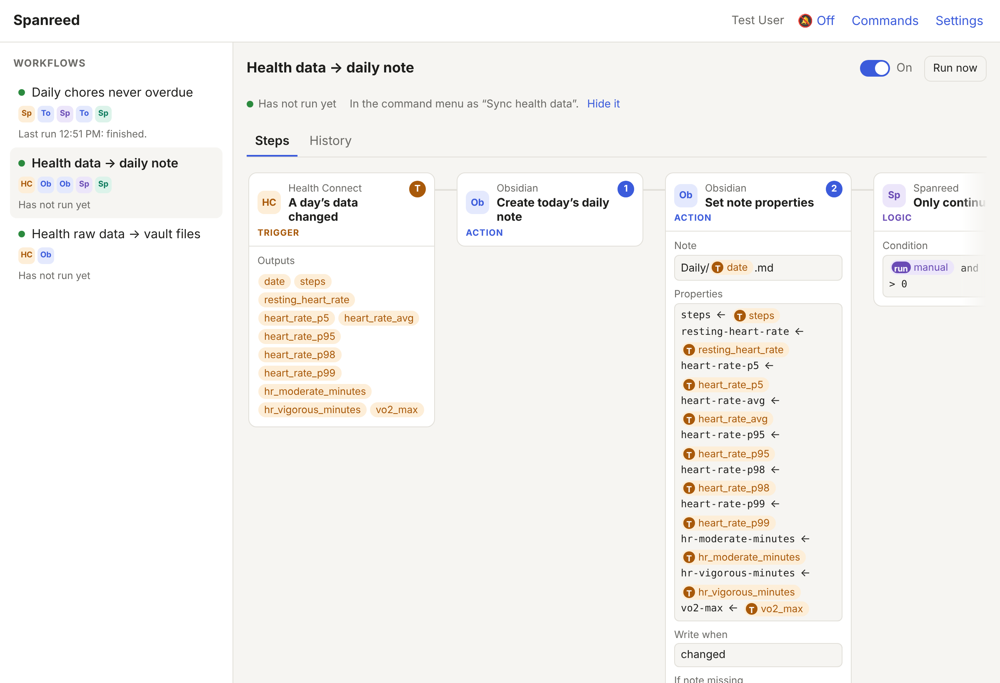

# Workflows

A workflow is an automation that a user owns: one trigger and an ordered list
of steps. Plugins publish the blocks that triggers and steps are made of, and
one engine runs every workflow.

This replaces behavior that used to be written into a plugin. A plugin decided
when it ran, what it did and whether it told you. A workflow keeps those apart,
so that each can be changed without code.

There is no editor yet. Workflows come from recipes. The web UI shows a
workflow's steps and the history of its runs, turns it on and off and runs it
(see [web-ui.md](web-ui.md#workflows)). The chat command **Manage workflows**
does the same without the pictures, and also adds a workflow from a recipe
and deletes one.

## The parts

| Part | What it is | Where |
| --- | --- | --- |
| Block | A unit with typed inputs and outputs. An `Action` is a step. A `Trigger` starts runs. | `spanreed/workflows/blocks.py` |
| Workflow | A trigger, steps, a name, and whether it is on. Stored as JSON for each user. | `spanreed/workflows/model.py` |
| Run | One execution, for one event of the trigger. Its trace holds what each step received and returned. | `spanreed/workflows/engine.py` |
| Recipe | A workflow that ships with Spanreed. Installing one copies it to the user. | `spanreed/workflows/recipes/*.json` |

`WorkflowsPlugin` (`spanreed/plugins/workflows.py`) is a core plugin, like User
Profile: every user is registered to it. It builds the block registry from
`Plugin.blocks()` of every loaded plugin, starts the engine, and owns **Manage
workflows**.

## A workflow as JSON

This is the recipe that replaced the Todoist No Overdue plugin:

```json
{
  "id": "todoist-no-overdue",
  "name": "Daily chores never overdue",
  "requires": ["todoist"],
  "command_hidden": true,
  "trigger": {"block": "core.schedule", "params": {"every": 4, "unit": "hours"}},
  "steps": [
    {"id": "find", "block": "todoist.find-tasks",
     "inputs": {"label": "spanreed/no-overdue", "due": "overdue"}},
    {"id": "any", "block": "core.continue-if",
     "inputs": {"condition": "{{ find.count > 0 }}"}},
    {"id": "move", "block": "todoist.set-due-date",
     "inputs": {"tasks": "{{ find.tasks }}", "due": "today"}},
    {"id": "tell", "block": "core.send-message",
     "inputs": {"message": "Updated {{ find.count }} overdue tasks to today."}}
  ]
}
```

A step's inputs can refer to what came before it, in Jinja syntax:

- `trigger`: the outputs of the trigger's event.
- `run`: the run itself. `{{ run.manual }}` is true for a run started by hand.
- The `id` of an earlier step: its outputs.

A text with a template in it gives text. A text that is one expression and
nothing else gives the value itself, so `"{{ find.tasks }}"` is a list and
`"{{ find.count > 0 }}"` is yes or no. Templates run in Jinja's sandbox, and a
name that does not exist is an error.

A workflow is checked when it is installed and when the engine starts: every
block must exist, the inputs must fit the block, and a template can only refer
to the trigger, the run or an earlier step. A workflow with a problem is not
started, and **Manage workflows** says what the problem is.

## Blocks

| Block | Kind | Published by |
| --- | --- | --- |
| `core.schedule` On a schedule | trigger | Workflows |
| `core.continue-if` Only continue if | logic | Workflows |
| `core.send-message` Send message | ask | Workflows |
| `todoist.find-tasks` Find tasks | action | Todoist |
| `todoist.set-due-date` Set due date | action | Todoist |
| `obsidian.create-daily-note` Create today's daily note | action | Obsidian |
| `obsidian.set-note-properties` Set note properties | action | Obsidian |
| `obsidian.write-file` Write file | action | Obsidian |
| `health-connect.day-changed` A day's data changed | trigger | Health Connect |
| `health-connect.raw-records-changed` Raw records changed | trigger | Health Connect |

More arrive with each plugin whose behavior becomes a recipe.

### Writing a block

An action names its input and output dataclasses as type arguments:

```python
@dataclass
class FindTasksInput:
    label: str
    due: Literal["any", "overdue"] = "any"

@dataclass
class FindTasksOutput:
    tasks: list[Any]
    count: int

class FindTasks(Action[FindTasksInput, FindTasksOutput]):
    id = "todoist.find-tasks"      # stable: stored workflows refer to it
    title = "Find tasks"

    async def run(self, ctx: StepContext, inputs: FindTasksInput) -> FindTasksOutput:
        todoist = await Todoist.for_user(ctx.user)
        ...
```

The plugin returns it from `blocks()`:

```python
class TodoistPlugin(Plugin[UserConfig]):
    def blocks(self) -> list[Block]:
        return todoist_blocks()
```

- The input values are checked against the dataclass with
  `spanreed.config_form`, the check that the settings form uses.
- A user's workflow can use a plugin's blocks while the user is registered to
  that plugin. Otherwise the step fails and says which plugin to set up.
- Raise `StopRun` to end the run at this step without failing it. Any other
  exception fails the run.
- A failed run is tried again from its first step, so a block must be safe to
  repeat.

### Triggers

A trigger names its parameters and its event, and yields an event each time
the workflow should run. The fields of the event are its outputs.

```python
class Schedule(Trigger[ScheduleParams, Tick]):
    id = "core.schedule"
    title = "On a schedule"
    Manual = NoQuestion

    async def events(self, ctx, params) -> AsyncIterator[Tick]:
        while True:
            ...
            yield tick
            await ctx.state.set("last_fired", ...)   # after the run is over
```

The engine runs the workflow for an event before it asks for the next one, so
the code after a `yield` runs when that run is over. The `yield` gives back
whether the run worked. `ctx.state` keeps small values, such as a cursor, for
each workflow across restarts.

#### Triggers that a plugin feeds

A `PushTrigger` is for a plugin that learns of changes itself, as Health
Connect does when the phone posts a payload. The plugin says what changed,
with one key for each thing:

```python
await DayChanged.emit(user, ["2026-05-09"])
```

The key waits in a queue, in Redis, for every workflow of the user that is on
and uses the trigger. The trigger turns a key into an event when the workflow
is ready to run for it:

```python
class DayChanged(PushTrigger[NoParams, DayMetrics]):
    id = "health-connect.day-changed"

    async def event_for(self, ctx, params, key) -> DayMetrics | None:
        return await day_metrics(ctx.user, datetime.date.fromisoformat(key))
```

- The event is built when the run starts, so it holds what is stored at that
  moment, and a key that is put twice before its run gives one run.
- A key leaves the queue when its run worked. A restart in the middle of a
  run finds the key again.
- If the run failed every time it was tried, the key goes behind the others
  and is tried again after them. Nothing is dropped while Obsidian is closed.
- A key that is put again during its own run stays, and gives another run.
- A workflow that is off gets no keys. It does not collect what it missed;
  a run by hand over a range fills that in.

`Manual` says whether the user can start a run by hand:

- `None`: no.
- `NoQuestion`: yes, and nothing is asked.
- A dataclass whose fields are `Literal`s: yes, after the user picks one choice
  for each field. `manual_events` gets the answers and returns the events to
  run.

`core.schedule` keeps the time of its last event. After a restart it fires at
once if it is due and waits for the rest of its interval if it is not. A new
workflow fires at once.

## Commands

A workflow whose trigger can be started by hand is a command, on every
surface, for the user who owns it. The command:

- has the id `workflow.<workflow id>`, so that renaming the workflow does not
  change it for surfaces that remember commands;
- is named after the workflow, unless the workflow has a `command_name`;
- is on by default, and `command_hidden` takes it out of the menu. A recipe
  that replaces a plugin ships with the commands that the plugin had, so
  "Daily chores never overdue" ships hidden;
- goes away while the workflow is off.

A run started by hand happens inside the command's flow, so its messages stay
on the surface it was started from. It is not tried again if it fails, and it
ends with one line that says how it went: `Daily chores never overdue: stopped
at step 2, Only continue if.`

`spanreed.interaction.commands` can now register a command for one user, and
surfaces check a command with `get_command_for_user` before they run it.

## What the engine does

- **One event, one run. One run at a time for each workflow.**
- **A failed run is tried again** for the same event: five times in all, with
  a pause of 60 seconds that doubles. After the last try the user is told
  once, and not again until a run works. The workflow stays on.
- **A workflow that keeps failing is tried twice an hour.** After those five
  tries, each event gets one try, no sooner than 30 minutes after the last
  failure, until a run works. A service that is down for a night is not asked
  hundreds of times.
- **A trigger that fails is started again** after a pause that doubles from 60
  seconds to 30 minutes, like a plugin that crashed.
- **Telegram flood control pauses the step**, not the run: the step waits for
  the ban plus a random extra and is tried again, up to three times. A run
  started by hand does not wait.
- **Values stay out of the log.** The engine logs which step ran and how it
  ended. A step's inputs and outputs are kept only in the run's trace.
- **Turning a workflow on or off takes effect at once.**

Not there yet: triggers that poll a service, branches and loops, blocks that
ask the user a question, the editor. A question a run is waiting on would not
survive a restart.

## Redis

| Key | Holds |
| --- | --- |
| `workflows:user_id={id}` | Set of the user's workflow ids |
| `workflows:workflow:{id}` | The workflow, as JSON |
| `workflows:workflow:{id}:state` | Hash of what its trigger remembers |
| `workflows:workflow:{id}:runs` | The traces of its last 100 runs, newest first. Dropped 30 days after the last run. |
| `workflows:workflow:{id}:queue` | List of the keys it still has to run for, oldest first |
| `workflows:workflow:{id}:queued` | Hash of those keys, each with a token that changes when the key is put again |
| `workflows:converted:{plugin}` | Set of the users whose use of a plugin was converted to recipes |

## Plugins that became recipes

`spanreed/workflows/migrations.py` moves the users, once each, at startup. A
user never has the old behavior and the new one, and doing it again changes
nothing.

### Retired: the whole plugin is a recipe

The plugin is deleted from the code. Each user who is still registered to it
gets the recipe and is told so, and the registration is dropped.

| Plugin | Recipe |
| --- | --- |
| Todoist No Overdue | Daily chores never overdue |

The schedule differs from the plugin in one way: the plugin ran at every
start of Spanreed and then every 4 hours, and the recipe runs every 4 hours
whether or not Spanreed was restarted in between.

### Converted: the plugin stays as the connection

The plugin keeps talking to its service. What it did with the data is now a
set of recipes, installed with the settings the user had.

| Plugin | What it still does | Recipes |
| --- | --- | --- |
| Health Connect | Receives the phone's payloads, stores every record, and says which days changed | Health data → daily note · Health raw data → vault files |




Where the settings of the Health Connect plugin went:

| Was | Is now |
| --- | --- |
| The ten daily note property checkboxes | The rows of **Properties** in "Health data → daily note". A property that was off has no row. |
| Raw data folder | The start of **Path** in "Health raw data → vault files" |
| Sync steps, Sync heart rate, Sync VO2 max | One command, **Sync health data**: today, the last week, or every stored day |
| Export Health Connect raw data | The command of "Health raw data → vault files", under the same name |
| Show Health Connect setup, Delete Health Connect data | Still commands of the plugin |

What differs from the plugin:

- **A day that could not be written is not lost.** The plugin wrote the
  metrics of a payload once and gave up if Obsidian did not answer. The
  workflow keeps the day in its queue until it is written.
- **One message for a day, not one for each kind of metric.** A sync by hand
  says `Logged steps=6227, heart-rate-avg=71 for 2026-05-09.` It names the
  properties it wrote, and says nothing about a day that was up to date.
- **A sync by hand writes what changed.** The plugin's commands wrote every
  value again without reading the note. The note ends up the same.
- **The note of each day gets every metric compared**, not only the kind that
  the payload carried. Only a value that differs is written.
